# Polyopticon

<p align="center">
  
</p>

<p align="center"><b>One screen for every source of a developing story</b></p>

Polyopticon is a desktop news-monitoring dashboard. It pulls news outlets, forums, imageboard posts, Twitch streams and chat, and other public sources into one configurable workspace, so you can follow a protest, a major media event, or any fast-moving story as it develops, in real-time.

Everything it uses is free; no paid APIs. Optional accounts (Telegram, Bluesky, free API keys) are stored encrypted on your computer.

<table>
  <tr>
    <td>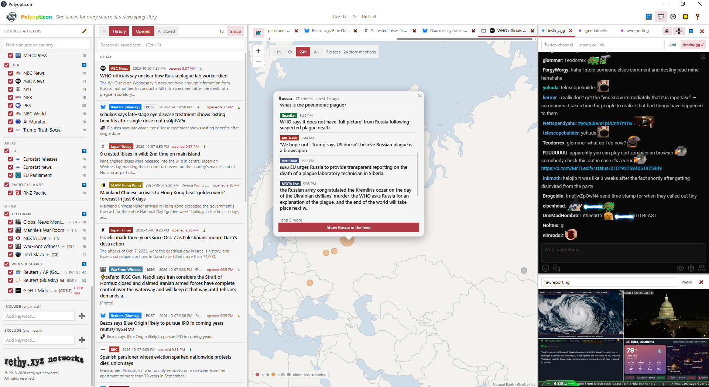</td>
    <td>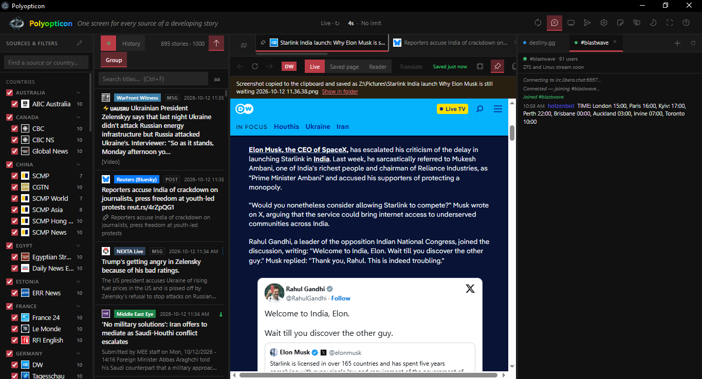</td>
    <td>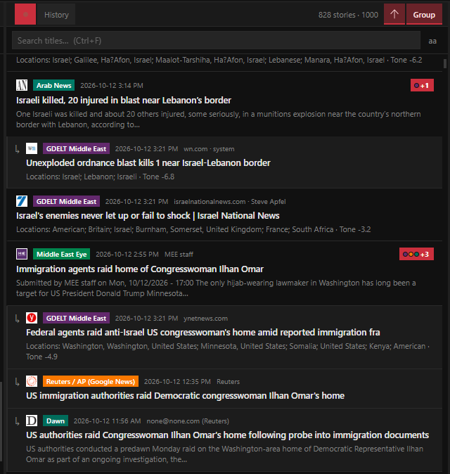</td>
  </tr>
  <tr>
    <td>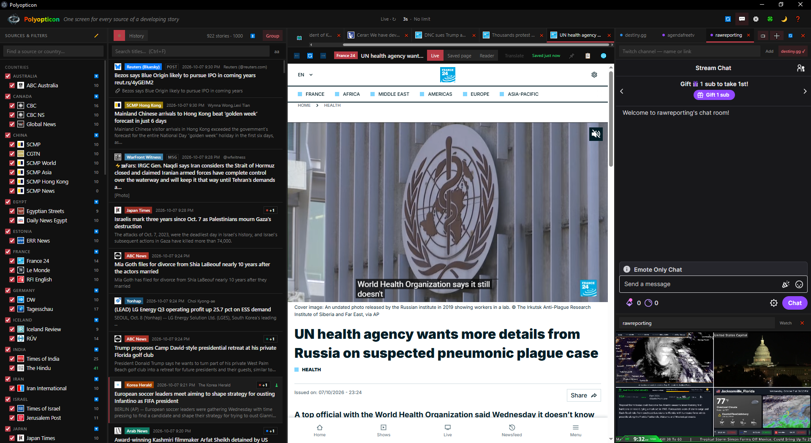</td>
    <td>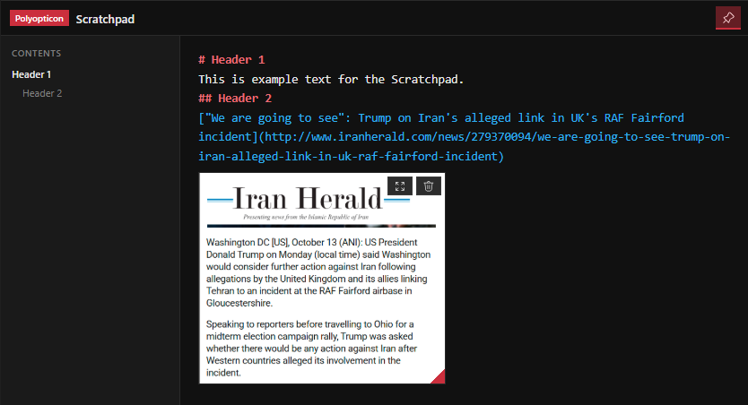</td>
    <td>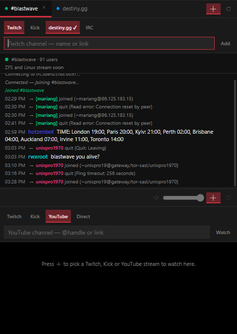</td>
  </tr>
  <tr>
    <td>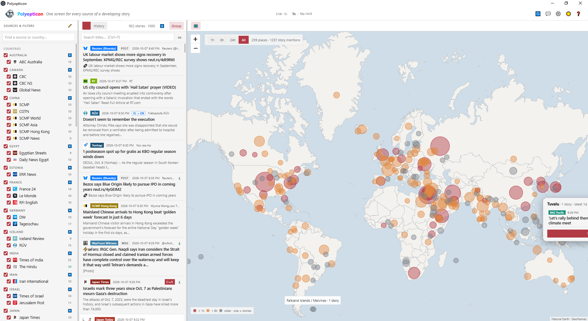</td>
    <td>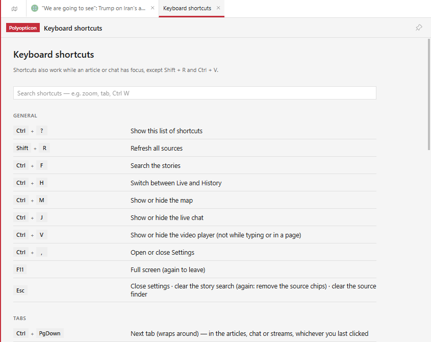</td>
    <td>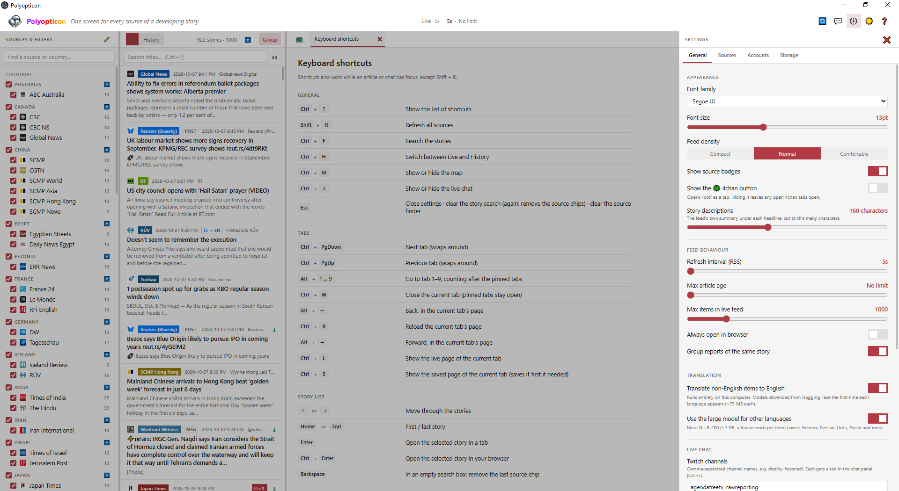</td>
  </tr>
</table>

## Contents

- [Getting Started](#getting-started)
- [Layout](#layout)
- [Toolbar](#toolbar)
- [Sources & Filters View](#sources--filters-view)
  - [Finding a Source](#finding-a-source)
  - [Source Groups](#source-groups)
  - [Data Sources](#data-sources)
  - [Include / Exclude Keywords](#include--exclude-keywords)
- [Article List View](#article-list-view)
  - [Live / History](#live--history)
  - [Search Bar](#search-bar)
  - [Auto-scroll](#auto-scroll)
  - [Group](#group)
  - [Story Rows](#story-rows)
- [Article View](#article-view)
  - [Tabs](#tabs)
  - [Article Bar](#article-bar)
  - [Offline Reading](#offline-reading)
  - [Translation](#translation)
  - [Map](#map)
  - [Other Tabs](#other-tabs)
- [Live Chat View](#live-chat-view)
  - [Adding a Chat](#adding-a-chat)
  - [Chat Tabs](#chat-tabs)
- [Video Player View](#video-player-view)
  - [Adding a Stream](#adding-a-stream)
  - [Stream Tabs](#stream-tabs)
  - [Volume and Mute](#volume-and-mute)
  - [Resizing](#resizing)
- [Settings](#settings)
  - [Data Folder](#data-folder)
  - [Ad Blocking](#ad-blocking)
- [Project Structure](#project-structure)
- [Credits](#credits)

## Getting Started

### Binary

Check the GitHub <a href="https://github.com/rethy-xyz-networks/Polyopticon/releases">releases</a> page for up-to-date portable binaries, and release information.

### Building

Requires [Node.js](https://nodejs.org/) 22 or newer (Windows; Electron is installed by npm).

```
npm install
npm start          # run
npm run dist       # build a portable Windows .exe into dist/
```

## Layout

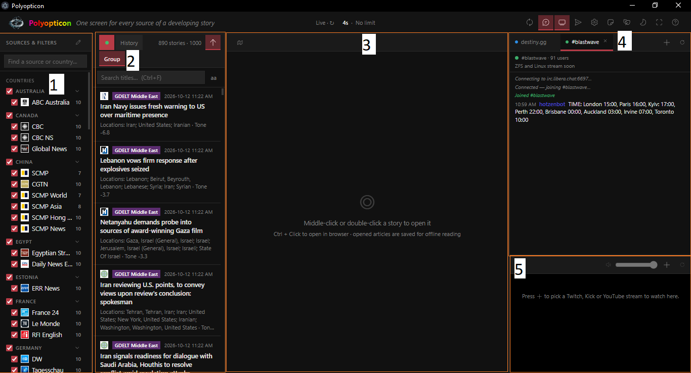

Polyopticon has five main areas, known as views, with the [toolbar](#toolbar) across the top:

- **[Sources & Filters View](#sources--filters-view)** (fig. 1): The sidebar on the left. It picks which outlets and wires feed in (grouped by country) and holds the include / exclude keywords (scroll to the bottom).
- **[Article List View](#article-list-view)** (fig. 2): The story list beside the sidebar. It shows incoming stories newest first (Live), or the stories you opened and everything stored (History).
- **[Article View](#article-view)** (fig. 3): The centre area, where articles and sites open as tabs. An article opens as a live page, a saved copy or a clean reader view. The map, Scratchpad, 4chan, Telegram pages and the shortcut list also open here as tabs.
- **[Live Chat View](#live-chat-view)** (fig. 4): Twitch, Kick, destiny.gg and IRC chats, in a column on the right (Ctrl+J).
- **[Video Player View](#video-player-view)** (fig. 5): Twitch, Kick, YouTube or direct-link streams below the chat, several at once, each with its own volume and mute (Ctrl+V).

Drag the bars between the views to resize them; the widths are remembered.

## Toolbar

The left of the toolbar shows the app's status: **Live** with a countdown to the next refresh (or **Refreshing…**), the oldest age a story can have to be listed (Settings → General → Max article age), and an **Offline** badge when there is no connection. While a translation model downloads or loads, its progress shows here too; click it to stop translating.

The buttons, from left to right:

- **Refresh** (Shift+R): polls every source now, without waiting for the countdown.
- **Chat** (Ctrl+J): shows or hides the [Live Chat View](#live-chat-view).
- **Split** (Ctrl+V): shows or hides the [Video Player View](#video-player-view) below the chat, opening the chat if it is hidden.
- **Telegram**: opens a [Telegram channel tab](#telegram-channel).
- **Settings** (Ctrl+,): opens the [Settings](#settings) panel; click again (or Esc) to close it.
- **Scratchpad**: opens the [Scratchpad](#scratchpad) tab.
- **4chan**: opens a [4chan /pol/ tab](#4chan). Optional; hide it in Settings → General.
- **Theme**: switches between the dark and light theme.
- **Full screen** (F11): fills the screen with the window; click again to leave.
- **Keyboard shortcuts** (Ctrl+?): opens the [shortcut list](#keyboard-shortcuts) as a tab.

## Sources & Filters View


The sidebar on the left. The **edit** button in its header opens Settings → Sources, where sources are added and edited.

### Finding a Source

The search box at the top of the sidebar finds a source by its name, its group (country) or its category. Every word typed must match, and accents and case don't matter (`ruv` finds RÚV), so typing a country shows all of its sources. Folded groups open while a search is active; Esc clears it.

### Source Groups

The sidebar lists sources in three sections:

- **Countries:** USA, Canada, Mexico, UK, Iceland, France, Germany, Ukraine, Russia, Turkey, Syria, Israel, Egypt, Qatar, Saudi Arabia, UAE, Iran, Pakistan, India, Thailand, China, Mongolia, Philippines, North Korea, South Korea, Japan and Australia.
- **Areas:** groups spanning several countries, such as the EU.
- **Other:** Telegram, then Wires & Search.

A source's group is the "Group" field in its editor; a new group name counts as a country unless it is one of the areas above.

- **Tick boxes:** untick a source to hide its stories from the list; the group's own box ticks or unticks all of its sources. Unticked sources keep being polled, and stay unticked after a restart.
- **Fold arrow:** folds a group away; folded groups are remembered.
- **Count:** the number beside each source is how many of its stories are in the live list. It turns green, orange and red as it grows. A failed poll shows its error instead (for example `HTTP 403` or `NO KEY`).
- **Icons:** each source shows its site's icon (the site's own icon for aggregated sources like GDELT and Google News, and the channel's avatar for Telegram), plus a small mark for its type (G for Google News, API for keyed sources, and so on).
- **Right-click a source** to limit the list to it; see [source chips](#search-bar).

### Data Sources

| Type | Account / key | Notes |
|---|---|---|
| RSS / Atom | none | Any feed URL |
| Google News search | none | Any Google News query: `site:`, `OR`, `"phrases"`, `when:1d` |
| GDELT | none | Worldwide English news every 15 min, filtered by keyword / theme / location |
| Bluesky | optional (app password) | Keyword search or one account's posts |
| Telegram | optional (your own api_id) | Public channels via t.me web preview; logging in adds instant delivery and channels without previews |
| The Guardian | free key | open-platform.theguardian.com |
| New York Times | free key | developer.nytimes.com (Times Newswire / Top Stories) |
| NewsAPI.org | free key | 100 requests/day, articles delayed 24h on the free plan |

Add and edit sources in **Settings → Sources**; keys and logins go in **Settings → Accounts** (encrypted with Windows DPAPI). To read a Telegram channel without adding it as a source, use a [Telegram channel tab](#telegram-channel).

#### How Feeds Are Polled

The **Refresh interval** (Settings → General) is the fastest a feed is ever asked. RSS and Atom feeds use conditional
requests (ETag / Last-Modified), so an unchanged feed costs a 304 and no download; for feeds that send no validators
(or ignore them), a body identical to the last one is dropped before it is parsed.

**The model: adaptive polling, per feed.** Standard polling asks every feed every 5 seconds, all day, however
often it publishes. Most feeds publish a few stories an hour, so almost all of those requests find nothing. Polyopticon
instead gives each feed its own schedule, based on what that feed has actually been doing:

| | Standard fixed polling | Polyopticon |
|---|---|---|
| Busy feed (new story on the last poll) | every 5 s | every 5 s (the Refresh interval) |
| Feed that has gone quiet | every 5 s, forever | after 2 empty polls the wait grows ×1.5 each time (7.5 s, 11 s, 17 s…) up to a **20 s ceiling** |
| Wait vs. how often the feed publishes | ignored | never longer than 1/20th of the feed's usual gap between stories (learned from its own item dates, then from what it publishes) |
| New story appears | n/a | the feed is back on 5 s on the very next poll |
| Server's `Cache-Control` hint | n/a | not obeyed (see below) |
| Requests | 100% | about 26% (74% fewer) |
| Story shown | within 5 s of appearing | on average 9 s later than fixed polling (never more than 20 s) |

A feed is only watched closely while it is active, and a quiet one is checked less often but never less than every 20 seconds, so a story is never held back for long. Each wait also gets ±10% random jitter, so feeds that started together don't all hit their servers at the same instant, and the wait is never shorter than the Refresh interval.

The 20 s ceiling is the trade-off: raising it saves more requests but shows stories later (a 30 s ceiling measured 14 s late on average for 82% fewer requests; 60 s measured 31 s late for 91% fewer). The server's `Cache-Control` hint is deliberately not obeyed: it is only a hint (a CDN can replace the copy as soon as a story is published), and measured against a 12-hour recording of the real feeds it made stories later for almost no saving. The numbers are at the top of `src/main/adapters/pacing.js`; `scripts/bench-polling/` records the real feeds at fixed 5 s polling and replays the scheme against that recording to measure how late it would have shown stories and how many requests it would have saved. The figures above come from a 12-hour recording of 71 feeds (1,187 new stories).

A source that fails twice in a row is retried after twice the wait, then four times, up to five minutes, and goes back to the normal interval after one success; a `Retry-After` from the server (429 / 503) is obeyed for up to an hour. Per-source counters (`polls · 304 · same body · downloaded`) and the current wait are in the state log as `src.<name>.net` and `src.<name>.pacing`. The logic is in `src/main/adapters/pacing.js`.

### Include / Exclude Keywords

At the bottom of the sidebar. Type a keyword and press Enter (or **+**) to add it.

- **Include:** when any include keyword is active, only stories matching at least one of them are listed.
- **Exclude:** stories matching any exclude keyword are hidden.

Matching ignores case. Each keyword has:

- **Tick box:** turns the keyword on or off without removing it.
- **Scope button:** where the keyword is looked for. Click to cycle through **T+D** (title and description), **T** (title only) and **D** (description only).
- **Close button:** removes the keyword.

Keywords are saved in `tags.json` and apply in both Live and History.

## Article List View


The story list. Middle-click or double-click a story to open it in the [Article View](#article-view); Ctrl+click opens it in your browser.

### Live / History

The switch at the top left (Ctrl+H toggles it):

- **Live** (the dot): incoming stories, newest first. The list holds the newest stories up to "Max items in live feed" (Settings), but every source always keeps its 10 newest there, so slow sources (a daily feed, a blog) aren't pushed out by busy ones.
- **History:** stories from the database. **Opened** lists the articles you opened, by day; **All stored** lists everything ever received. Its search covers titles, summaries and the full text of saved articles.

Every item from every source is stored in `polyopticon.db`, so the list is filled instantly on launch. The number beside the switch is how many stories are listed.

### Search Bar

- **Search** (Ctrl+F): filters the list by title.
- **aa / Aa:** makes the search case-sensitive (Live only).
- **Source chips:** right-click a source (in the sidebar, or a story's source badge) to limit the list to it; add several to search across them. The chips override the sidebar's tick boxes. The close button on a chip, Backspace in an empty search box, or Esc twice removes them. Works in History too.
- **Place chip:** appears when the [map](#map) filters the list to a place; its close button clears it.

### Auto-scroll

The auto-scroll button (Live only) jumps the list back to the top whenever new stories arrive. Turn it off to stay where you are while reading down the list.

### Group

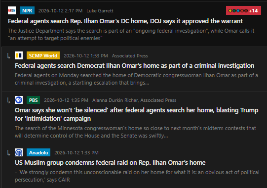

Reports of the same story from different sources are grouped (the **Group** button). Headlines are compared by their distinctive words, weighted by rarity, within a 36-hour window; the "+N" chip on a story expands the other reports. Groups are stored with each item.

### Story Rows

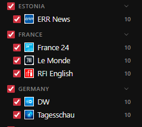

Each story shows its source badge, its publisher's icon, its title and when it was published, with the feed's own description below (cut to the length set in Settings → General → Story descriptions).

Site icons are fetched once from the site (falling back to Google's favicon service when a site blocks it), shrunk to 32 px and cached in `%LocalAppData%\Polyopticon\icons` (`src/main/favicons.js`, served as `polyopticon-icon://`).

With headline translation on (see [Translation](#translation)), non-English headlines appear immediately and update when their translation is ready; hover the "AR → EN" tag for the original.

## Article View


The centre area. Opened stories, the map and the special tabs below all open here.

### Tabs

- **Drag a tab** to reorder it.
- **Right-click a tab** for pin / close others / close to the right.
- **Middle-click** or Ctrl+W closes a tab.
- **Pinned tabs** (the pin button in the article bar, right-click → Pin, or Ctrl+P) stay at the left, ignore middle-click and Ctrl+W, and reopen in the same view (Live / Saved page / Reader) the next time the app starts.
- **Tab keys:** Ctrl+PgDown / Ctrl+PgUp move between tabs, Alt+1 to 9 jumps to a tab, and Ctrl+Shift+A searches the open tabs.

The open tabs are remembered in `pinned.json`: articles, 4chan and Telegram pages, the Scratchpad and the shortcut list come back in order, pinned or not, with the selected tab selected again.

### Article Bar

The bar above an open article, from left to right:

- **Back / Reload / Forward** (Alt+←, Ctrl+R, Alt+→): page navigation.
- **Source and title** of the story.
- **Live / Saved page / Reader:** switches between the real page, the saved full-page copy and the clean text. When the site can't be reached (or you're offline) the saved copy opens automatically.
- **Translate / Stop:** see [Translation](#translation).
- **Save state:** "Saving…", "Saved 2m ago" (with "· partial" when the site only sent part of the article), or "Not saved". In Live view, click it to save the page again, for example after logging in.
- **Screenshot** (Ctrl+Shift+S): captures the whole page, copies it to the clipboard and saves it as a picture (folder set in Settings → General → Article viewer).
- **Pin:** pins or unpins the tab.
- **Copy link:** copies the article's address.
- **Add to Scratchpad:** adds a link to the article to the end of the [Scratchpad](#scratchpad).
- **Open in browser:** opens the article in your system browser.

Ctrl+= / Ctrl+- / Ctrl+0 zoom the page in, out and back; the default zoom is in Settings → General → Article viewer.

### Offline Reading

- Opening an article saves it twice: the full page as MHTML (`snapshots/<id>.mhtml`) and a clean
  Readability extraction in the database. Articles opened in the system browser are saved by a hidden window.
- Before saving, login/subscribe walls, consent banners, newsletter prompts and fade overlays are removed
  and lazy images are loaded (`src/main/page/`); the live tab is put back as it was right after.
  Text comes from whichever works best: Readability, per-site rules, the page's JSON-LD, or its paragraphs.
  Telegram/Bluesky posts use the post text itself.
- When a site only sent part of an article (e.g. NYT after the free-article limit), the save is marked
  "partial". Log in to the site once in a Live tab; the session persists, so later saves get the full text.
- Saved pages are kept for 90 days by default (Settings → Storage); their text is kept forever.

### Translation

<table>
  <tr>
    <td>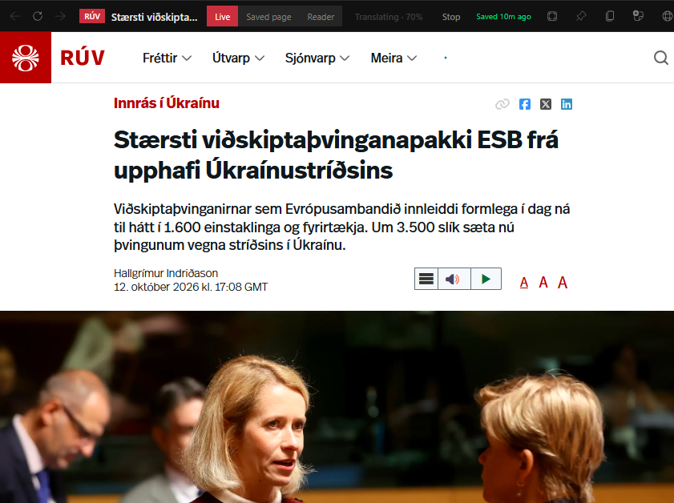</td>
    <td>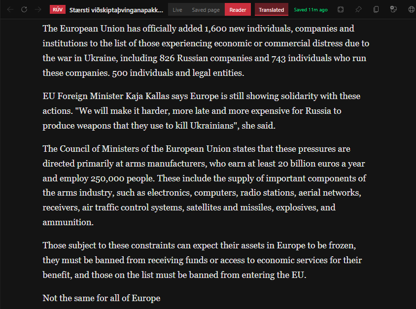</td>
  </tr>
</table>

Translation is manual and runs entirely on your computer (no service, no key). Machine-translation models:
Opus-MT (~75 MB each, ~0.5 s per headline) for ~25 languages, and Meta's NLLB-200 (~1 GB, a few seconds
per item) for Turkish, Hebrew, Persian, Urdu, Icelandic, Slovak, Croatian and others. Models download from Hugging Face the first time a
language is translated and are kept in `%LocalAppData%\Polyopticon\models`.

- **Articles:** the **Translate** button in the article bar translates the open article to English and shows
  it in Reader view (it saves the page first if needed); **Original** switches back. It's greyed out for
  articles that are already in English. The button shows how far along it is: model download (first use of a
  language only), model loading, then the percentage of the article translated. Long articles in the large
  model take a few minutes.
- **Headlines:** off by default. Turn on Settings → General → Translation to translate non-English
  headlines as they arrive; they appear immediately and update when their translation is ready. Hover the
  "AR → EN" tag for the original.

The **Stop** button next to Translate (or Settings → General → Stop all translation) ends a translation at any time. Headline translation (off by default) repeats all this for every non-English headline, so with the NLLB languages it keeps the CPU busy. Leave it off if that's a concern.

#### Benchmark

**Translation is taxing.** It runs on your CPU, uses most of its threads while it works, and how hard and how long depends on the language, and your CPU. Roughly, for one short paragraph (four sentences, 300-450 characters), it's the following:

| Languages | Model | Time | CPU while working |
|---|---|---|---|
| French, German, Spanish, Italian, Portuguese, Russian, Ukrainian, Polish, Arabic, Chinese, Japanese, Korean | Opus-MT | 1–3 s | about half of all threads |
| Icelandic, Slovak, Slovenian, Croatian, Turkish, Greek | NLLB-200 | 11–14 s | about a third of all threads |
| Hebrew, Persian | NLLB-200 | 18 s | about a third of all threads |

**Benchmark Hardware**: Two Intel Xeon E5-2660 v4 (2016; 14 cores / 28 threads each at 2.0 GHz, 56 threads in all), 96 GB DDR4-2133, Windows 10 IoT Enterprise LTSC. Models ran 8-bit quantized on the CPU only (no GPU), one at a time, already loaded. It contains many cores but a slow clock rate, so any newer CPU with a high clock rate will finish faster.

A 5,000-character article takes around half a minute with an Opus-MT language, 3 minutes with NLLB, and 5 minutes with Hebrew or Persian. The first use of each language also downloads its model (~75 MB, or ~1 GB for NLLB) and loads it (a second or two for Opus-MT; up to a couple of minutes for NLLB the first time).

### Map

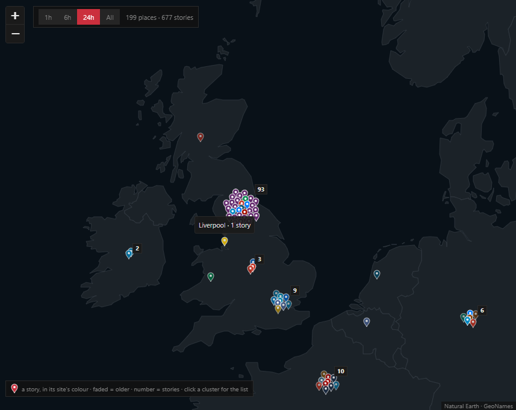

The **Map** button (Ctrl+M) at the left of the tab strip shows where the stories in the live list are happening.
Each story is a pin in its site's colour, faded as it gets older (< 1h, < 6h, < 24h, older).
A place's pins gather in a cluster with the number of stories; places that would overlap at
the current zoom share one cluster, which splits again as you zoom in. A cluster never grows
past 30 pins, however many stories it holds.

- **1h / 6h / 24h / All:** shows only stories published within that window.
- **Click a cluster** for the list of its stories, with a search box (title, site or place; Enter opens the first match), or **Show … in the feed** to filter the list to its places (shown as a [place chip](#search-bar)).

Places come from an offline gazetteer: countries, ~4,200 cities, US states, Canadian,
Australian and Indian states, Chinese provinces, conflict-zone towns, seas and regions. The
title decides where a story is; the summary only narrows it down (Russia → Irkutsk). Words
like "Israeli", "Houthis" or "Kremlin" point at a country but place a story there only when
nothing more specific does. Names that are also first names or surnames (Vladimir, Austin)
need a place context, and a source's sidebar group (its country) breaks ties such as
Hyderabad, India vs Pakistan. See [docs/map-audit.md](docs/map-audit.md) for how this was
measured; `tests/unit/geotag-corpus.json` holds the hand-labelled articles it is tested on.

The base map is fully offline (Natural Earth outlines); no tile server or API key.
Rebuild the gazetteer after editing its lists with `node scripts/build-geo.js`; bump
`GEOTAG_VERSION` in `src/main/enrich/geotag.js` when results change, so stored stories are
re-tagged at the next start. Data: GeoNames (CC BY 4.0) and Natural Earth (public domain).

### Other Tabs

#### Telegram Channel

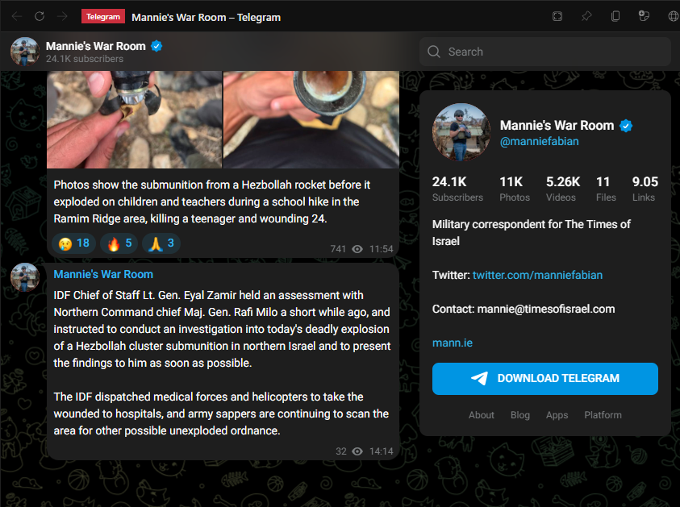

To read a public Telegram channel directly, press the **Telegram** button in the toolbar. A new tab opens with a field where the title would be; enter the channel's name or link (`durov`, `@durov`, `t.me/durov`) and press Enter, and the field gives way to Telegram's own web view of the channel (`t.me/s/<channel>`). It's live only: nothing from it is saved, and it runs on its own in-memory browser session. Like article tabs it can be dragged, pinned (it reopens at the next start), zoomed, and moved with Back / Forward / Reload, and middle-clicking a link opens it as another tab in the background.

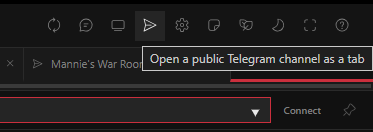

#### Scratchpad

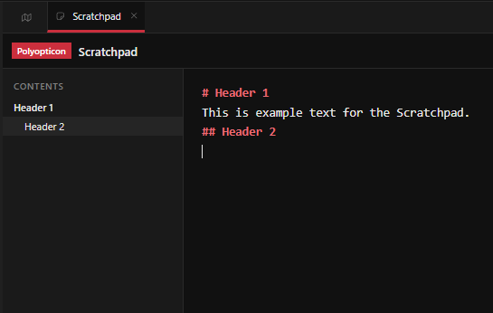

The **Scratchpad** button in the toolbar opens the Scratchpad as a tab: one permanent note, like a notepad document.
Paste or type text (Markdown is highlighted) and paste or drop images into it: each image appears inline,
right where it was pasted. Click it to enlarge (then scroll to zoom in and out, drag to move), drag its corner or Ctrl+scroll over it to resize,
and use the delete button (or Delete) to remove it. The article bar's **Add to Scratchpad** button adds a link to the open article.

It saves by itself: after a short pause in typing, when you leave or close the tab, and when the app closes. It is stored encrypted with your
Windows account (`scratchpad.bin`); if Windows encryption is unavailable it is not written to disk at all.

#### 4chan

The toolbar's optional **4chan** button opens 4chan /pol/ as a live-only tab (hide the button in Settings → General). Middle-click any link there to open it in a background tab. Nothing from these tabs is saved, and they run on their own in-memory browser session, so no cookies or cache reach the disk.

#### Keyboard Shortcuts

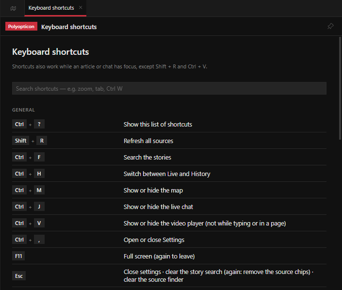

**Ctrl+?** (or the **Keyboard shortcuts** button in the toolbar) opens the full list of keyboard shortcuts and mouse actions in a tab, with a search box. The list comes from `src/renderer/shortcuts.js`, which also decides which keys the app handles; add new shortcuts there and they show up in the list automatically.

## Live Chat View

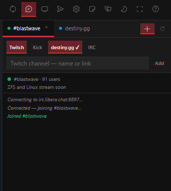

**Chat** (toolbar, Ctrl+J) opens a column on the right with Twitch and Kick channel chats, the destiny.gg chat and
IRC rooms, one tab each. The column is hidden and no chats are set up on a fresh install. All chats stay connected while the column is hidden.

### Adding a Chat

The **+** button in the column's header shows a row of chat types:

- **Twitch:** a field for the channel name or link. Read-only (guest), and follows the app's light/dark theme.
- **Kick:** a field for the channel name or link; the chat is Kick's embed at `chat.kick.cx/embed/<channel>`.
- **destiny.gg:** switches the chat on or off (no details needed). Read-only (guest).
- **IRC:** fields for a server and a room. **Connect** joins the room anonymously: a random guest nick,
  no password, no login. Servers are encrypted by default (`irc.libera.chat`, or with a port,
  `irc.example.org:6697`); use `irc://host:6667` for a plain-text server. IRC rooms are read-only and
  reconnect by themselves if the link drops. The log shows the connection steps (connecting, connected,
  joined) and people joining, leaving, quitting, changing nick, being kicked and topic changes.

Twitch and destiny.gg chats run on their own browser session and open links in your browser. The list is also in Settings → General → Live chat.

### Chat Tabs

- **Reload** (the button beside **+**, or Ctrl+R): reloads the chat that's showing.
- **Close button** on a tab (or middle-click) removes it.
- Chat tabs work like the article tabs: drag to reorder, and right-click for pin / close others / close to the right. Pinned tabs stay at the left and have no close button.

The order and pins are remembered.

## Video Player View

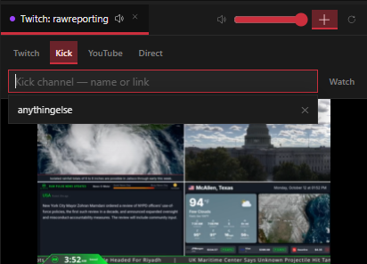

The **Split** button (toolbar, Ctrl+V) adds a stream player below the chat, opening the chat if it is hidden. Several streams can play at once, and they keep playing while you switch between tabs.

### Adding a Stream

Press the **+** button in the stream bar (it works like the chat's), pick a site, type a channel (or paste its link, which picks the site for you) and press **Watch**:

- **Twitch:** a channel name or link.
- **Kick:** a channel name or link.
- **YouTube:** an `@handle` or channel ID; plays that channel's `/live` page, trimmed to just the video.
- **Direct:** a link to a video or audio file (`.mp4`, `.webm`, `.mp3` and so on), played in the built-in video player on its own in-memory session.

### Stream Tabs

Each stream is a tab, like the chats: add as many as you like, drag to reorder, right-click to pin or close others, and use the close button or middle-click to close. **Reload** (beside **+**) reloads the stream that's showing.

### Volume and Mute

Each stream has its own volume:

- **Volume slider** (stream header): sets the volume of the stream that's showing.
- **Speaker button** (stream header): mutes or unmutes the stream that's showing. Its icon follows the volume.
- **Speaker on each tab:** mutes or unmutes that stream without switching to it.

### Resizing

Drag the bar between chat and streams to resize. The streams stop when the split or the chat column is closed; the tabs, pins, split and height are remembered.

## Settings

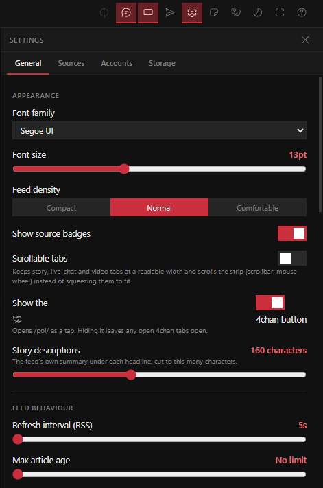

The **Settings** button (Ctrl+,) opens the panel; Esc or the close button closes it. It has four tabs:

- **General:**
  - *Appearance:* font, font size, feed density, source badges, scrollable tabs, the 4chan button, and description length.
  - *Feed behaviour:* refresh interval, max article age, max items in the live feed, always open in browser, and grouping.
  - *Translation:* automatic headline translation, the large NLLB model, and Stop all translation.
  - *Live chat:* Twitch and Kick channels, destiny.gg, and IRC rooms (also set from the chat's **+**).
  - *Article viewer:* default page zoom and the screenshot folder.
  - *Polling:* the delay between sources at start (takes effect on restart).
  - *Logs:* how many session logs to keep, and debug logging.
- **Sources:** add, edit, enable and disable sources, grouped like the sidebar.
- **Accounts:** API keys and logins (Telegram, Bluesky, The Guardian, New York Times, NewsAPI), encrypted with Windows DPAPI.
- **Storage:** how much is saved, how long saved pages are kept, **Open data folder**, **Clear articles** and **Clear models**.

### Data Folder

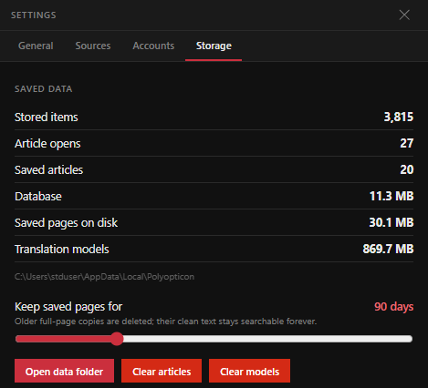

Everything the app stores lives outside the repository, in `%LocalAppData%\Polyopticon\`:
`polyopticon.db` (items, history, saved text), `snapshots/` (saved pages), `models/` (translation models),
`icons/`, `logs/`, `accounts.bin` (encrypted keys and sessions), `scratchpad.bin` (the encrypted Scratchpad note), and `settings.json`, `tags.json`,
`ui.json`, `pinned.json` (the open tabs).

The app reopens the way you left it: window size, position and maximised state, pane widths,
unticked sources, Live/History (and its scope), the Group / auto-scroll / case toggles, the map and its
time window, the chat column (`ui.json`), keyword filters (`tags.json`), and the open tabs (`pinned.json`).

To run a separate copy with its own data (e.g. for testing), set `POLYOPTICON_DATA_DIR` to another folder
before `npm start`.

### Ad Blocking

Article and 4chan pages block ads and trackers: a built-in list of ad/tracker hosts, plus EasyList and EasyPrivacy through Ghostery's adblocker engine (URL rules and hiding of empty ad slots). The lists download in the background on first launch, are kept in the data folder and refresh weekly (`src/main/blocker.js`).

## Project Structure

```
├── package.json            scripts, dependencies, electron-builder config
├── scripts/
│   ├── build-geo.js        builds the gazetteer and the offline world map
│   └── build-icons.js      builds icons.js from Fluent UI System Icons
└── src/
    ├── main/               Electron main process (Node)
    │   ├── main.js         entry: window, IPC, webview security, reader view, startup
    │   ├── feed-worker.js  utility process hosting the source adapters; writes items to SQLite
    │   ├── translator.js   utility process running the translation models
    │   ├── adapters/       one adapter per source type; types.js describes their settings; pacing.js decides how often feeds are polled
    │   ├── enrich/         language detection, story grouping, place tagging (gazetteer.json)
    │   ├── page/           scripts injected into article pages before saving (cleanup, extraction, images)
    │   ├── db.js           SQLite schema, migrations and queries (node:sqlite, FTS5)
    │   ├── snapshots.js    MHTML + text capture, background capture, retention
    │   ├── favicons.js     site icons, fetched once and cached
    │   ├── chat.js         chat-panel session and webview lock-down
    │   ├── irc.js          anonymous, read-only IRC connections for the chat column
    │   ├── fourchan.js     4chan tabs: in-memory session, middle-click → new tab
    │   ├── perfwatch.js    CPU / hang watchdog for the session log
    │   ├── secrets.js      encrypted API keys and sessions (Windows DPAPI)
    │   ├── blocker.js      ad/tracker blocking (host list + EasyList) for article and 4chan tabs
    │   ├── config.js       default sources (seeded on first run, added on upgrade)
    │   ├── store.js        settings.json, tags.json, ui.json, pinned.json
    │   ├── logger.js       session and debug logs
    │   └── preload.js      the `window.polyopticon` bridge to the UI
    └── renderer/           UI: plain ES modules, no build step
        ├── index.html, styles.css
        ├── app.js          entry: boot, toolbar, keyboard, splitters
        ├── icons.js        the button icons (generated by scripts/build-icons.js)
        ├── telegram.js     parsing Telegram channel names and t.me links for the Telegram button
        ├── streams.js      Twitch / Kick / YouTube stream names, links and player pages for the split
        ├── reorder.js      drag-to-reorder for the tab strips (articles, chats)
        ├── feed.js, history.js, tabs.js, scratchpad.js, map.js, chat.js, irc.js, sidebar.js, settings.js, sourcesearch.js
        ├── state.js, ui.js, dom.js
        └── assets/         logo, offline world map, icon licence
```

## Credits

Place data from [GeoNames](https://www.geonames.org/) (CC BY 4.0) and [Natural Earth](https://www.naturalearthdata.com/) (public domain).

Translation models: Helsinki-NLP Opus-MT and Meta NLLB-200, via Transformers.js.

Article extraction: Mozilla Readability. Map: Leaflet.

Icons: [Fluent UI System Icons](https://github.com/microsoft/fluentui-system-icons) by Microsoft (MIT, see `src/renderer/assets/fluent-icons-LICENSE.txt`).

<hr>

<p align="center">
  <a href="https://rethy.xyz"></a>
</p>
