# Polyopticon

<p align="center">
  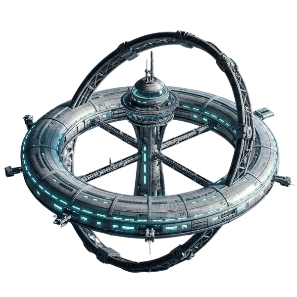
</p>

<p align="center"><b>Desktop news-monitoring dashboard: RSS, Telegram, Bluesky, IRC, GDELT, and more in one live feed, with offline translation, a story map, and Twitch/Kick chat and streams.</b></p>

> **Pre-release software.** Polyopticon is still under active development, so expect bugs, issues, and features that change or break between versions. Please report problems you run into.

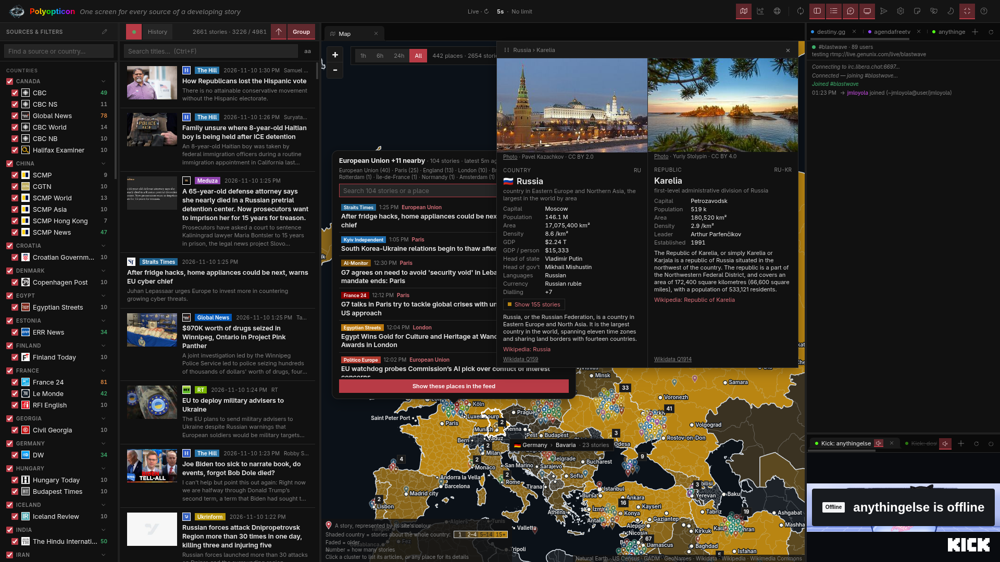

Polyopticon is a desktop news-monitoring dashboard. It pulls news outlets, forums, imageboard posts, Twitch streams and chat, and other public sources into one configurable workspace, so you can follow a protest, a major media event, or any fast-moving story as it develops, in real time.

Everything it uses is free. No paid APIs. Optional accounts (Telegram, Bluesky, free API keys) are stored encrypted on your computer.

## Contents

- [Getting Started](#getting-started)
  - [Binary](#binary)
  - [Building](#building)
- [Layout](#layout)
- [Toolbar](#toolbar)
- [Sources & Filters View](#sources--filters-view)
  - [Finding a Source](#finding-a-source)
  - [Source Groups](#source-groups)
  - [Data Sources](#data-sources)
    - [How Feeds Are Polled](#how-feeds-are-polled)
  - [Include / Exclude Keywords](#include--exclude-keywords)
- [Article List View](#article-list-view)
  - [Live / History](#live--history)
  - [Search Bar](#search-bar)
  - [Auto-scroll](#auto-scroll)
  - [Group](#group)
  - [Story Rows](#story-rows)
- [Article View](#article-view)
  - [Article Tabs](#article-tabs)
  - [Article Bar](#article-bar)
  - [Offline Reading](#offline-reading)
  - [Translation](#translation)
    - [Benchmark](#benchmark)
  - [Bias chart](#bias-chart)
  - [Global Markets](#global-markets)
  - [Opinion Polls](#opinion-polls)
  - [Map](#map)
  - [Other Tabs](#other-tabs)
    - [Telegram Channel](#telegram-channel)
    - [Scratchpad](#scratchpad)
    - [4chan](#4chan)
    - [Keyboard Shortcuts](#keyboard-shortcuts)
- [Live Chat View](#live-chat-view)
  - [Adding a Chat](#adding-a-chat)
  - [Chat Tabs](#chat-tabs)
- [Video Player View](#video-player-view)
  - [Adding a Stream](#adding-a-stream)
  - [Stream Tabs](#stream-tabs)
  - [Volume and Mute](#volume-and-mute)
  - [Resizing](#resizing)
- [Tabs](#tabs)
  - [Using Tabs](#using-tabs)
  - [Popping a Tab Out](#popping-a-tab-out)
  - [Pinned Tabs](#pinned-tabs)
  - [Keyboard](#keyboard)
  - [Tab Search](#tab-search)
- [Settings](#settings)
  - [Data Folder](#data-folder)
  - [Site Logins and Cookies](#site-logins-and-cookies)
  - [Ad Blocking](#ad-blocking)
- [Project Structure](#project-structure)
- [API Usage](#api-usage)
- [Credits](#credits)

## Getting Started

### Binary

Check the GitHub <a href="https://github.com/rethy-xyz-networks/Polyopticon/releases">releases</a> page for up-to-date portable binaries and release information.

New binaries are built for each release.

### Building

Requires [Node.js](https://nodejs.org/) 22 or newer, on Windows or Linux. Each build has to be made on the platform it's for.

```
npm install
npm start          # run
npm run dist       # build a portable Windows .exe into dist/
npm run dist:linux # build a Linux AppImage into dist/
```

Publishing a release on GitHub builds both and attaches them to it (`.github/workflows/release.yml`).

## Layout

Polyopticon has five main areas, known as views, with the [toolbar](#toolbar) across the top:

- **[Sources & Filters View](#sources--filters-view)**: The sidebar on the left. It picks which outlets and wires (grouped by country) populate the **Article List View** feed, and holds the include / exclude keywords (bottom of the list).
- **[Article List View](#article-list-view)**: The article list to the right of the **Sources & Filters View**. It displays incoming articles by newest first (Live), or the articles you opened previously (History).
- **[Article View](#article-view)**: The centre area, where articles and sites open as separate tabs. An article opens by default as a live page, and supports a saved copy or a clean reader view. The map, Scratchpad, 4chan, Telegram pages, a map card's Wikipedia articles and photos, and the shortcut list also open within this view as separate tabs. Wikipedia and 4chan tabs lead with the site's own icon, as article tabs do with their source's. The [bias chart](#bias-chart), [Global Markets](#global-markets), [Opinion Polls](#opinion-polls) and the map are not tabs: each replaces the article area while open.
- **[Live Chat View](#live-chat-view)**: Twitch, Kick, destiny.gg and IRC chats, in a column on the right (Ctrl+J).
- **[Video Player View](#video-player-view)**: Twitch, Kick, YouTube or direct-link streams below the chat, several at once, each with its own volume and mute (Ctrl+V).

Drag the bars between the views to resize them. Width and height per view are recorded and remembered.

The **Sources & Filters View** (Ctrl+Shift+F) and the **Article List View** (Ctrl+Shift+E) can be hidden from their toolbar buttons, which gives the room to the **Article View**. A hidden view comes back as it was (scroll position, search). Searching the stories (Ctrl+F) or switching Live / History (Ctrl+H) shows the list again. Both choices are remembered.

## Toolbar

The centre of the toolbar shows the app's status: **Live** with a countdown to the next refresh (or **Refreshing…**), the oldest age a story can have to be listed (Settings -> General -> Max article age), and an **Offline** badge when there is no connection. While a translation model downloads or loads, its progress shows here too (which can be clicked to stop it during translation).

The buttons, from left to right:

- **Refresh** (Shift+R): Polls every source immediately.
- **Sources & Filters** (Ctrl+Shift+F): Shows or hides the [Sources & Filters View](#sources--filters-view).
- **Article List** (Ctrl+Shift+E): Shows or hides the [Article List View](#article-list-view); the Article View takes its width.
- **Chat** (Ctrl+J): Shows or hides the [Live Chat View](#live-chat-view).
- **Video** (Ctrl+V): Shows or hides the [Video Player View](#video-player-view) below the chat, or opens the chat if it is hidden.
- **Telegram**: Opens a [Telegram channel tab](#telegram-channel) within the **Article View**.
- **Bias chart** (Ctrl+B): Shows or hides the [bias chart](#bias-chart), plotting each news feed's outlet by political lean and reliability.
- **Global Markets** (Ctrl+G): Shows or hides [Global Markets](#global-markets), live prices in groups of tickers you make.
- **Opinion polls** (Ctrl+O): Shows or hides [Opinion Polls](#opinion-polls): voting intention, leaders, approval and standing questions, by country.
- **Settings** (Ctrl+,): Toggles the [Settings](#settings) panel.
- **Scratchpad**: Opens the [Scratchpad](#scratchpad) tab within the **Article View**.
- **4chan**: Opens a [4chan /pol/ tab](#4chan) within the **Article View** (optional, hide it in *Settings -> General*).
- **Theme**: Switches between the dark and light theme.
- **Full screen** (F11): Toggleable, click again to leave. With the window selected it makes the window full screen; after clicking in the open article it makes just that article full screen (also the button in the article's info bar).
- **Keyboard shortcuts** (Ctrl+?): Opens the [shortcut list](#keyboard-shortcuts) tab within the **Article View**.

## Sources & Filters View

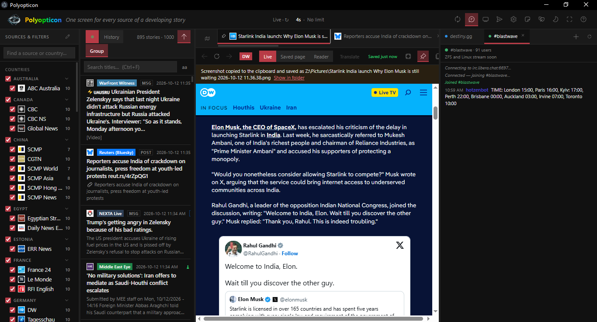

The sidebar on the left. The **edit** button in its header opens Settings -> Sources, where sources are added and edited.

### Finding a Source

The search box at the top of the **Sources & Filters View** sidebar finds a source by its name, its group (country) or its category. Every word typed must match, and accents and case don't matter (`rte` finds RTÉ), so typing a country shows all of its sources. Folded groups open while a search is active. Esc clears the search.

### Source Groups

The sidebar lists sources in three sections:

- **Countries:** USA, Canada, Mexico, UK, Iceland, France, Germany, Ireland, Sweden, Denmark, Finland, Poland, Hungary, Serbia, Croatia, Ukraine, Russia, Georgia, Syria, Israel, Egypt, Qatar, UAE, Iran, Pakistan, India, Singapore, Vietnam, Thailand, China, Mongolia, North Korea, South Korea, Japan, Uruguay and more.
- **Areas:** Groups spanning several countries: the EU, the Balkans, Africa, and International (outlets and analysis with a world focus, such as Euronews, UN News and Foreign Policy).
- **Other:** Wires & Search, Disasters & Health (NASA) and Business (FT, Bloomberg, CNBC, MarketWatch).

A source's group is the "Group" field in its editor. A new group name counts as a country unless it is one of the areas above.

- **Tick boxes:** Untick a source to hide its stories from the list. The group's own box ticks or unticks all of its sources. Unticked sources keep being polled, and stay unticked after a restart.
- **Fold arrow:** Folds a group away. Folded groups are remembered.
- **Count:** The number beside each source is how many of its stories are in the live list. It turns green, orange and red as it grows. A failed poll shows its error instead (for example `HTTP 403` or `NO KEY`).
- **Icons:** Each source shows its site's icon (the site's own icon for aggregated sources like GDELT and Google News, and the channel's avatar for Telegram), plus a small mark for its type (G for Google News, API for keyed sources, and so on).
- **Right-click a source** to limit the list to it. See [source chips](#search-bar).

### Data Sources

| Type | Account / key | Notes |
|---|---|---|
| RSS / Atom | none | Any feed URL |
| Google News search | none | Any Google News query: `site:`, `OR`, `"phrases"`, `when:1d` |
| GDELT | none | Worldwide English news every 15 min, filtered by keyword / theme / location |
| Bluesky | optional (app password) | Keyword search or one account's posts |
| Telegram | optional (your own api_id) | Public channels via t.me web preview. Logging in adds instant delivery and channels without previews |
| The Guardian | free key | open-platform.theguardian.com |
| New York Times | free key | developer.nytimes.com (Times Newswire / Top Stories) |
| NewsAPI.org | free key | 100 requests/day, articles delayed 24h on the free plan |

Add and edit sources in **Settings -> Sources**. Keys and logins go in **Settings -> Accounts** (encrypted with Windows DPAPI). To read a Telegram channel without adding it as a source, use a [Telegram channel tab](#telegram-channel).

#### How Feeds Are Polled

The **Refresh interval** (Settings -> General) is the fastest a feed is ever asked. RSS and Atom feeds use conditional requests (ETag / Last-Modified), so an unchanged feed costs a 304 and no download. For feeds that send no validators (or ignore them), a body identical to the last one is dropped before it is parsed.

**Adaptive polling, per feed**: Standard polling asks every feed every 5 seconds, all day, however often it publishes. Most feeds publish a few stories an hour, so almost all of those requests find nothing, stressing the client and server. Polyopticon instead gives each feed its own independent schedule, based on what that feed has actually been doing:

| | Standard fixed polling | Polyopticon |
|---|---|---|
| Busy feed (new story on the last poll) | every 5 s | every 5 s (the Refresh interval) |
| Feed that has gone quiet | every 5 s, forever | after 2 empty polls the wait grows ×1.5 each time (7.5 s, 11 s, 17 s…) up to a **20 s ceiling** |
| Wait vs. how often the feed publishes | ignored | never longer than 1/20th of the feed's usual gap between stories (learned from its own item dates, then from what it publishes) |
| New story appears | n/a | the feed is back on 5 s on the very next poll |
| Server's `Cache-Control` hint | n/a | not obeyed (see below) |
| Requests | 100% | about 26% (74% fewer) |
| Story shown | within 5 s of appearing | on average 9 s later than fixed polling (never more than 20 s) |

A feed is only watched closely while it is active, and a quiet one is checked less often but at least every 20 seconds, so a story is never held back for long. Each wait also gets ±10% random jitter, so feeds that started together don't all hit their servers at the same instant, and the wait is never shorter than the Refresh interval.

The 20 s ceiling is the trade-off: raising it saves more requests but shows stories later (a 30 s ceiling measured 14 s late on average for 82% fewer requests. 60 s measured 31 s late for 91% fewer). The server's `Cache-Control` hint is deliberately not obeyed: it is only a hint (a CDN can replace the copy as soon as a story is published), and measured against a 12-hour recording of the real feeds it made stories later for almost no saving. The numbers are at the top of `src/main/adapters/pacing.js`. `scripts/bench-polling/` records the real feeds at fixed 5 s polling and replays the scheme against that recording to measure how late it would have shown stories and how many requests it would have saved. The figures above come from a 12-hour recording of 71 feeds (1,187 new stories).

A source that fails twice in a row is retried after twice the wait, then four times, up to five minutes, and goes back to the normal interval after one success. A `Retry-After` from the server (429 / 503) is obeyed for up to an hour. Per-source counters (`polls · 304 · same body · downloaded`) and the current wait are in the state log as `src.<name>.net` and `src.<name>.pacing`. The logic is in `src/main/adapters/pacing.js`.

### Include / Exclude Keywords

At the bottom of the **Sources & Filters View**. Type a keyword and press Enter (or **+**) to add it.

- **Include:** When any include keyword is active, only stories matching at least one of them are listed.
- **Exclude:** Stories matching any exclude keyword are hidden.

Matching ignores case. Each keyword has:

- **Tick box:** Turns the keyword on or off without removing it.
- **Scope button:** Where the keyword is matched. Click to cycle through **T+D** (title and description), **T** (title only), and **D** (description only).
- **Close button:** Removes the keyword.

Keywords are saved in `tags.json` and apply in both Live and History.

## Article List View

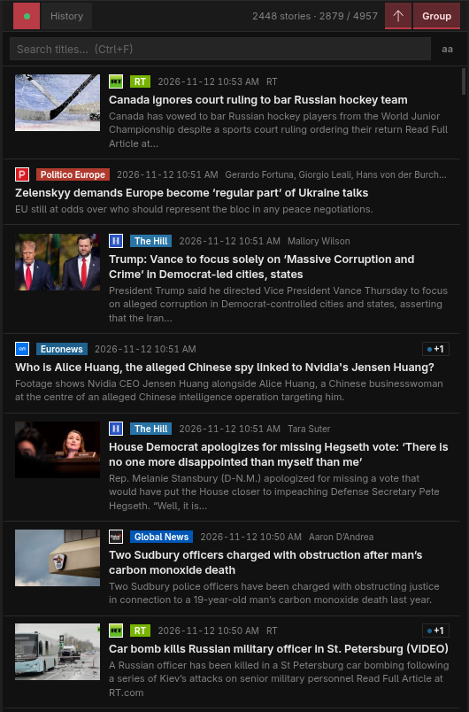

The story list. Middle-click or double-click a story to open it in the [Article View](#article-view). Ctrl+click opens it in your browser.

### Live / History

The switch at the top left (Ctrl+H toggles it):

- **Live** (the dot): Incoming stories, newest first. The list holds the newest stories up to "Max items in live feed" (Settings), but every source always keeps its 10 newest there, so slow sources (a daily feed, a blog) aren't pushed out by busy ones.
- **History:** Stories from the database. **Opened** lists the articles you opened, by day. **All stored** lists everything ever received. Its search covers titles, summaries and the full text of saved articles.

Every item from every source is stored in `polyopticon.db`, so the list is filled instantly on launch. The number beside the switch is how many stories are listed.

### Search Bar

- **Search** (Ctrl+F): filters the list by title.
- **aa / Aa:** makes the search case-sensitive (Live only).
- **Source chips:** right-click a source (in the sidebar, or a story's source badge) to limit the list to it. Add several to search across them. The chips override the sidebar's tick boxes. The close button on a chip, Backspace in an empty search box, or Esc twice removes them. Works in History too.
- **Place chip:** appears when the [map](#map) filters the list to a place. Its close button clears it.

### Auto-scroll

The auto-scroll button (Live only) jumps the list back to the top whenever new stories arrive. Turn it off to stay where you are while reading down the list.

### Group

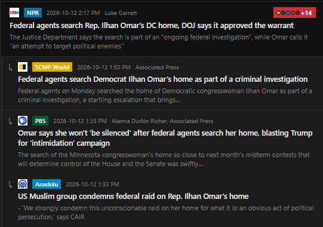

Reports of the same story from different sources are grouped (the **Group** button). Headlines are compared by their distinctive words, weighted by rarity, within a 36-hour window. The "+N" chip on a story expands the other reports. Groups are stored with each item.

### Story Rows

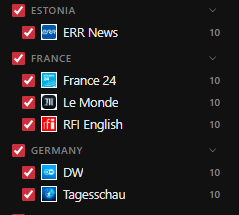

Each story shows its source badge, its publisher's icon, its title and when it was published, with the feed's own description below (cut to the length set in Settings -> General -> Story descriptions).

Site icons are fetched once from the site (falling back to Google's favicon service when a site blocks it), shrunk to 32 px and cached in `%LocalAppData%\Polyopticon\icons` (`src/main/favicons.js`, served as `polyopticon-icon://`).

When a feed gives a story a picture (Media RSS `media:content`/`media:thumbnail`, an image enclosure, or the first picture in its description), the row shows it on the left (smaller when the story list is at its narrowest); stories without one show text only. Hovering a picture shows it larger beside the list, at most 360 px wide and 60% of the window's height. The app fetches the picture itself (the window never contacts the publisher's image servers), shrinks it to 192 px wide (720 px for the hover preview) and keeps it for a week in `%LocalAppData%\Polyopticon\thumbs` (`src/main/thumbs.js`, served as `polyopticon-icon://thumb/<story id>`).

Non-English headlines show their language as a tag (e.g. "AR"). To read one in English, open it and use **Translate** (see [Translation](#translation)).

## Article View

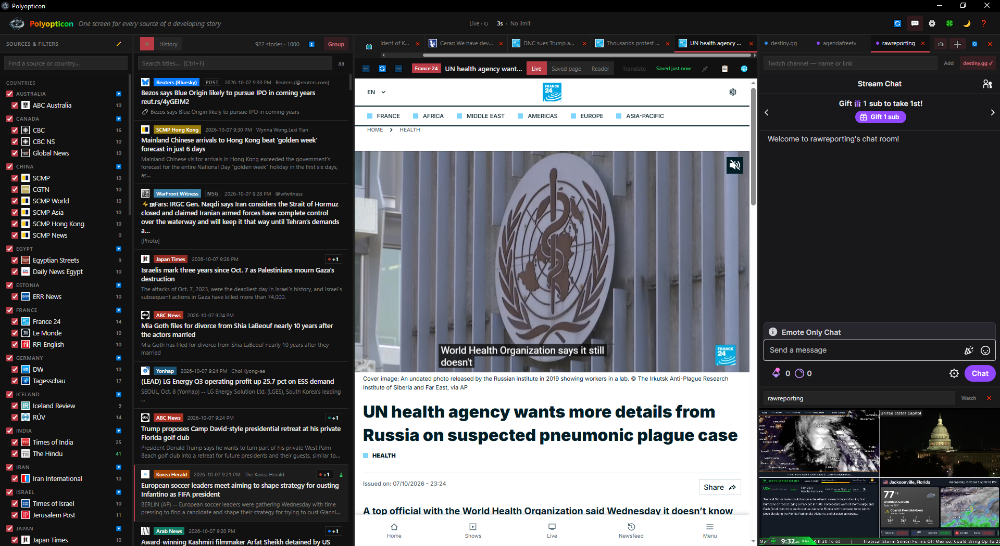

The centre area. Opened stories, the map and the special tabs below all open here.

### Article Tabs

Article tabs work like every other tab strip (see [Tabs](#tabs)). Pinned article tabs also reopen in the same view (Live / Saved page / Reader) the next time the app starts.

The open tabs are remembered in `pinned.json`: articles, 4chan and Telegram pages, the Scratchpad and the shortcut list come back in order, pinned or not, with the selected tab selected again.

### Article Bar

The bar above an open article, from left to right:

- **Back / Reload / Forward** (Alt+Left, Ctrl+R, Alt+Right): page navigation.
- **Source and title** of the story.
- **Live / Saved page / Reader:** switches between the real page, the saved full-page copy and the clean text. Reader keeps the text in a readable column, or fills the tab if *Reader text width* is set to Full width in Settings. When the site can't be reached (or you're offline), the saved copy opens automatically.
- **Translate / Stop:** see [Translation](#translation).
- **Save state:** "Saving…", "Saved 2m ago" (with "· partial" when the site only sent part of the article), or "Not saved". In Live view, click it to save the page again, for example after logging in.
- **Screenshot** (Ctrl+Shift+S): captures the whole page, copies it to the clipboard and saves it as a picture (folder set in Settings -> General -> Article viewer).
- **Pin:** pins or unpins the tab.
- **Copy link:** copies the article's address.
- **Add to Scratchpad:** adds a link to the article to the end of the [Scratchpad](#scratchpad).
- **Open in browser:** opens the article in your system browser.

Ctrl+= / Ctrl+- / Ctrl+0 zoom the page in, out and back. The default zoom is in Settings -> General -> Article viewer.

### Offline Reading

- Opening an article saves it twice: the full page as MHTML (`snapshots/<id>.mhtml`) and a clean
  Readability extraction in the database. Articles opened in the system browser are saved by a hidden window.
- Before saving, login/subscribe walls, consent banners, newsletter prompts and fade overlays are removed
  and lazy images are loaded (`src/main/page/`). The live tab is put back as it was right after.
  Text comes from whichever works best: Readability, per-site rules, the page's JSON-LD, or its paragraphs.
  Telegram/Bluesky posts use the post text itself.
- When a site only sent part of an article (e.g. NYT after the free-article limit), the save is marked
  "partial". Log in to the site once in a Live tab. The login persists across launches (see [Site Logins and Cookies](#site-logins-and-cookies)), so later saves get the full text.
- Saved pages are kept for 90 days by default (Settings -> Storage). Their text is kept forever.

### Translation

<table>
  <tr>
    <td>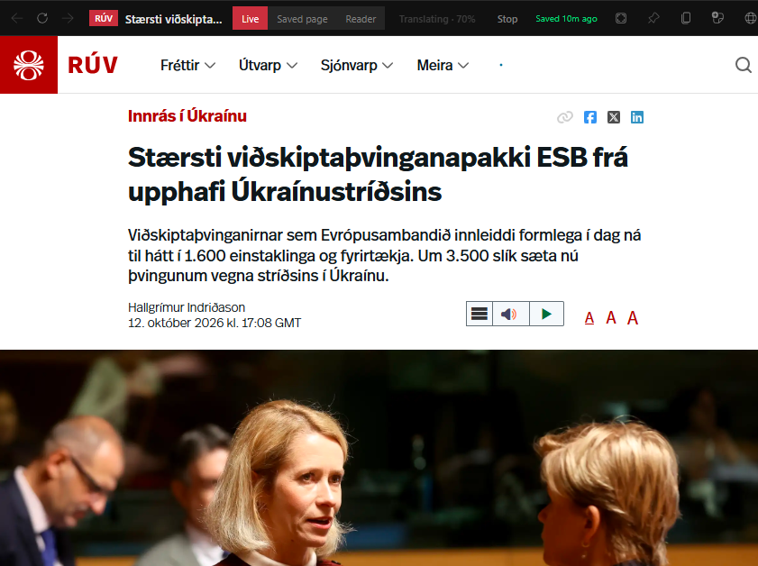</td>
    <td>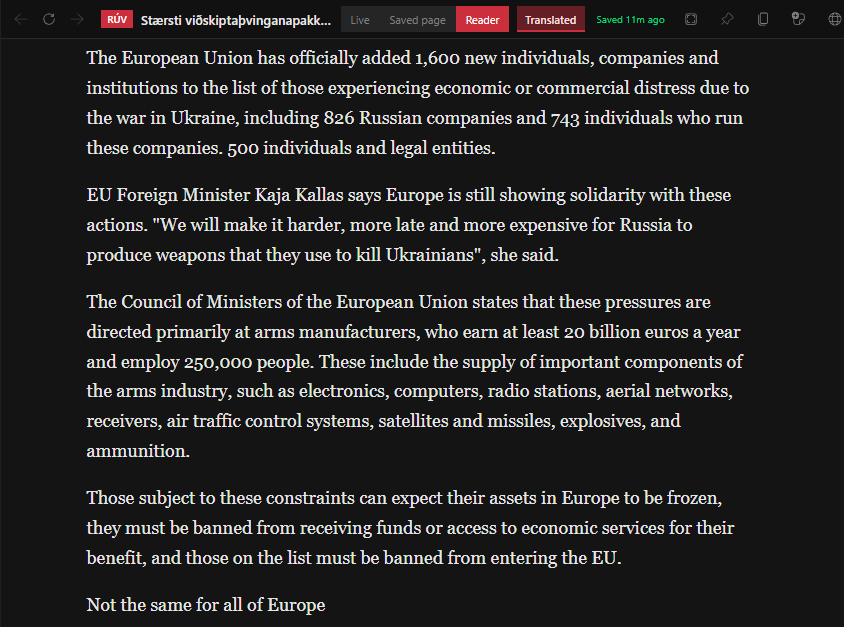</td>
  </tr>
</table>

Translation is manual, one article at a time, and runs entirely on your computer (no service, no key). Machine-translation models:
Opus-MT (~75 MB each, ~0.5 s per paragraph) for ~25 languages, and Meta's NLLB-200 (~1 GB, a few seconds
per item) for Turkish, Hebrew, Persian, Urdu, Icelandic, Slovak, Croatian and others. Models download from Hugging Face the first time a
language is translated and are kept in `%LocalAppData%\Polyopticon\models`.

The **Translate** button in the article bar translates the open article to English and shows it in Reader
view (it saves the page first if needed). **Original** switches back. It's greyed out for articles that are
already in English. The button shows how far along it is: model download (first use of a language only),
model loading, then the percentage of the article translated. Long articles in the large model take a few
minutes.

The **Stop** button next to Translate (or Settings -> General -> Stop all translation) ends a translation at any time.

#### Benchmark

**Translation is taxing.** It runs on your CPU, uses most of its threads while it works, and how hard and how long depends on the language, and your CPU. Roughly, for one short paragraph (four sentences, 300-450 characters), it takes:

| Languages | Model | Time | CPU while working |
|---|---|---|---|
| French, German, Spanish, Italian, Portuguese, Russian, Ukrainian, Polish, Arabic, Chinese, Japanese, Korean | Opus-MT | 1–3 s | about half of all threads |
| Icelandic, Slovak, Slovenian, Croatian, Turkish, Greek | NLLB-200 | 11–14 s | about a third of all threads |
| Hebrew, Persian | NLLB-200 | 18 s | about a third of all threads |

**Benchmark Hardware**: Two Intel Xeon E5-2660 v4 (14 cores / 28 threads each at 2.0 GHz, 56 threads in all), 96 GB DDR4-2133, Windows 10 IoT Enterprise LTSC. Models ran 8-bit quantized on the CPU only (no GPU), one at a time, already loaded. It contains many cores but a slow clock rate, so any newer CPU with a high clock rate will finish faster.

A 5,000-character article takes around half a minute with an Opus-MT language, 3 minutes with NLLB, and 5 minutes with Hebrew or Persian. The first use of each language also downloads its model (~75 MB, or ~1 GB for NLLB) and loads it (a second or two for Opus-MT. Up to a couple of minutes for NLLB the first time).

### Bias chart

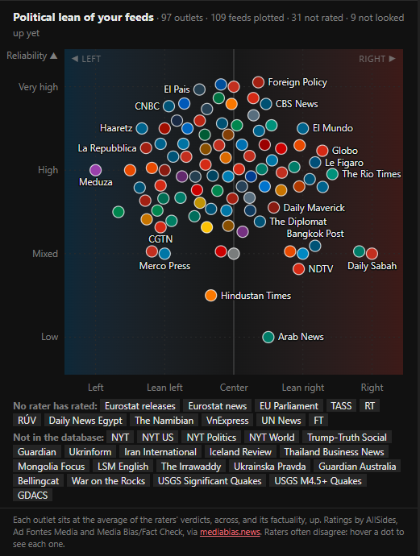

The **Bias chart** button (Ctrl+B), next to the map button in the header, plots each news feed's outlet by political lean (left to right) and reliability (bottom to top). Like the map it is a special view that replaces the article area, not a tab. Hover a dot for each rater's verdict; click it for the full rating on mediabias.news. Feeds of one outlet (the five SCMP feeds) share a dot.

Ratings come from the [MediaBias News API](https://mediabias.news), which republishes the verdicts of AllSides, Ad Fontes Media and Media Bias/Fact Check. A dot sits at the *average* of the raters' verdicts (finer than the API's own five-step rating, and raters that disagree pull it between steps).

- **One lookup per feed.** Each RSS feed is looked up once, shortly after start-up (or when you add it), and the answer is remembered in the database, whether or not an outlet was found. **Settings -> General -> Media bias -> Recheck** forgets every answer and asks again.
- **Matching** uses the website's domain, from the feed address and from the links of its stories, and accepts an outlet only if its domains include it, so look-alike names don't match.
- **Not plotted:** feeds the database doesn't know (NYT, The Guardian …), and outlets no rater has rated (RT …). They're listed under the chart.
- The API allows about 120 requests a minute; lookups are paced under that and wait out a refusal.

### Global Markets

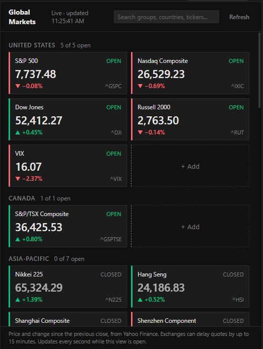

The **Global Markets** button (Ctrl+G), next to the bias button, shows a tile per instrument with its exact current price and today's change (▲ / ▼ and a percent, measured from the previous close). Like the map it is a special view that replaces the article area, not a tab. The groups are your own: there are none at first. **+ New group** makes one (type a name, press Enter), and hovering a group's header shows **Remove**, which asks once more if the group still has tiles. Each group header counts how many of its markets are open, and tiles for closed markets are dimmed. Nothing historical is kept.

- **Live, but only while you look.** Prices come from Yahoo Finance's unofficial quote endpoint: one batch request per second covers every tile. It polls only while the view is open and the window visible. Measured: one request per second for five minutes, and two per second for a minute, drew no rate limiting. There is no documented limit, so on a 429 or an error the poller backs off (5, 10, 30, then 60 s, or the server's Retry-After) and the header says so.
- **Adding a tile.** Each group ends in **+ Add**: type a Yahoo symbol (`SOL-USD`, `^GSPC`, `AAPL`); it is checked against Yahoo and added to that group. Hover a tile and click **×** to remove it, or drag it to another place or group. Groups and their tiles are kept in `ui.json` (`marketsGroups`).
- **Search.** The box in the header filters the tiles by group, name or ticker symbol. **Refresh** reconnects and fetches the prices at once.
- Exchanges can delay quotes by up to 15 minutes.

### Opinion Polls

The **Opinion polls** button (Ctrl+O), next to Global Markets, shows the opinion polls Wikipedia lists for a country, one question at a time: a tile per answer with its polling average and how far it moved in the last 30 days, a chart of the average with every poll as a dot, and the table of polls, newest first, each linked to the firm's own release. Events between polls (by-elections, new leaders) are dashed lines on the chart and rows in the table; the last election is the starting point. **3M / 6M / 1Y / All** sets how far back the chart and table go. An approval question leads with the net (approve minus disapprove), and a seat projection counts seats rather than percentages. Clicking a party or person (its tile, its column heading in the table, or its label at the end of its line) opens its Wikipedia article as a tab, as the map's place cards do.

The first list chooses the country, the second the question; both are remembered:

| Country | Questions |
|---|---|
| Canada | Voting intention · Preferred prime minister · Government approval · By province, by riding, and with another party leader · Each province's next election · Quebec independence · Alberta separation · Canada joining the United States |
| Germany | Voting intention (Union and CDU/CSU apart, East/West, by state, other scenarios) · Preferred chancellor · Preferred coalition |
| United Kingdom | Voting intention (Great Britain, and by nation or region) · Leader approval · Party approval · Other politicians · Hypothetical leaders · Scottish independence (and its timing) · Rejoining the EU (with the euro, and the relationship wanted) |
| Ireland | Voting intention |
| France | Presidential first round · Second-round match-ups · A rerun of 2022 |
| European Union | Parliament vote by group · Seats by group |
| United States | Trump job approval (polls, averages, by state, by group) · Approval of his policies and officials · 2028 head-to-heads, nationwide and by state |
| Australia | Voting intention (primary and two-party preferred) · By electorate · Right direction / wrong track |
| New Zealand | Party vote · By electorate · By group of voters · Preferred prime minister · Leader approval · Government direction |
| Poland | Voting intention · Other scenarios · By city · Candidates |
| Netherlands | Seats · Vote share |
| Ukraine | Presidential first round · Second-round match-ups (now and before 2022) |
| Japan | Voting intention · Party identification · Cabinet approval · Preferred prime minister · Preferred coalition |

A question made of several tables (a province, a riding, a leader, a match-up) gets a third list for which one to show. A question is listed only while Wikipedia has polls for it, so a province with none yet is absent, and a table with a single poll shows as that poll. The pages and tables each question comes from are listed in `src/main/poll-countries.js`; a table Wikipedia reshapes beyond reading keeps its last good copy.

- **Where the polls come from.** No polling firm or agency publishes an open feed of every poll, so the polls come from the tables Wikipedia's editors keep (each country's next election, such as [Canada's](https://en.wikipedia.org/wiki/Opinion_polling_for_the_next_Canadian_federal_election), and the articles on standing questions), each row citing the firm's release. They are read through the public MediaWiki API: no key, no login. The text is CC BY-SA 4.0, credited in the view with a link to the table shown. The titles asked for are Wikipedia's "next election" redirects, so a new election's page is followed without an update.
- **The average.** Each day's value is a weighted mean of the polls that ended in the window before it: each firm's latest poll counts once (so a weekly tracker doesn't outweigh a monthly poll), and a poll counts less as it ages. The window is 21 days where polls are frequent and longer where they are rare (three times the usual gap between polls, up to 120 days); the view says which.
- **How often.** The pages are checked when the view opens, at most every 30 minutes (Refresh at most once a minute), and saved in `polls/`, so they show at once and while offline. A check is one small request for every page's revision number, and a second for the text of the pages edited since (usually one or none). It checks only while the view is open, and only the country shown, so Wikipedia's rate limit is never approached. A busy answer (`429` / `503`) waits for Retry-After, a block an hour, and a failure is retried by itself, longer each time.

### Map

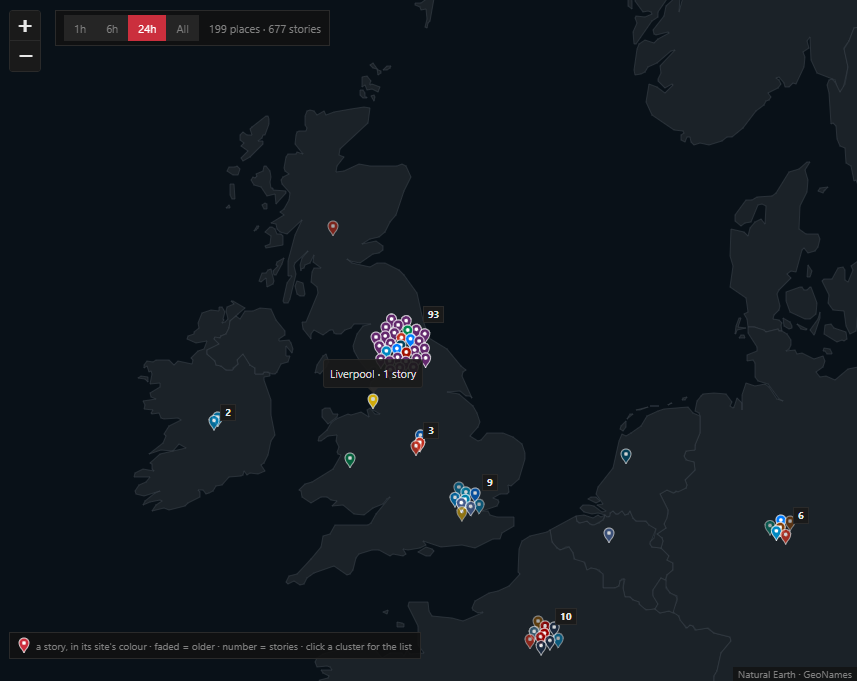

The **Map** button (Ctrl+M) at the top right of the header shows where the stories in the live list are happening. Each story is a pin in its site's colour, faded as it gets older (< 1h, < 6h, < 24h, older). A place's pins gather in a cluster showing the number of stories. Places that would overlap at the current zoom share one cluster, which splits again as you zoom in. A cluster never grows past 30 pins, however many stories it holds.

- **1h / 6h / 24h / All:** shows only stories published within that window.
- **Click a cluster** for the list of its stories, with a search box (title, site or place. Enter opens the first match), or **Show … in the feed** to filter the list to its places (shown as a [place chip](#search-bar)).
- **Hover** anywhere for the name of the place under the pointer, with the places it's in (Canada › Nova Scotia › Halifax County).
- **Click a place** (a country, a UK nation, a state or province, a US county or Canadian census division, or a city) for its card: a pane for it and for each place it's in, with facts, a summary and a photo, and **Show N stories** for the stories about it. Click a photo (or its credit) to open its Wikimedia Commons page, with the full-size image, author and licence, as a tab. Its **Wikipedia** link opens the article as a tab too. Drag the card by its title bar; Esc, × or a click on the sea closes it.

Places come from an offline gazetteer: countries, ~4,200 cities, US states, Canadian,
Australian and Indian states, Chinese provinces, conflict-zone towns, seas and regions. The
title decides where a story is. The summary only narrows it down (Russia -> Irkutsk). Words
like "Israeli", "Houthis" or "Kremlin" point at a country but place a story there only when
nothing more specific does. Names that are also first names or surnames (Vladimir, Austin)
need a place context, and a source's sidebar group (its country) breaks ties such as
Hyderabad, India vs Pakistan. See [docs/map-audit.md](docs/map-audit.md) for how this was
measured. `tests/unit/geotag-corpus.json` holds the hand-labelled articles it is tested on.

The base map works offline: no tile server or API key. Outlines, facts and summaries ship with the app. Two things are downloaded when the map first needs them, and saved: place photos (Wikimedia Commons thumbnails, places in the news first) and Canada's census divisions (GADM, whose licence allows non-commercial use but not redistribution, so each copy of the app fetches its own). Until they arrive the map works without them. Rebuild the gazetteer after editing its lists with `node scripts/build-geo.js`. Bump `GEOTAG_VERSION` in `src/main/enrich/geotag.js` when results change, so stored stories are re-tagged at the next start. Data: GeoNames (CC BY 4.0) and Natural Earth (public domain).

### Other Tabs

#### Telegram Channel

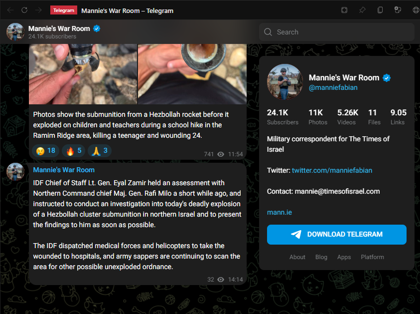

To read a public Telegram channel directly, press the **Telegram** button in the toolbar. A new tab opens with a field where the title would be. Enter the channel's name or link (`durov`, `@durov`, `t.me/durov`) and press Enter, and the field gives way to Telegram's own web view of the channel (`t.me/s/<channel>`). It's live only: no copy of it is saved. It runs on its own browser session (shared with 4chan tabs), whose logins and cookies last between launches. Like article tabs it can be dragged, pinned (it reopens at the next start), zoomed, and moved with Back / Forward / Reload, and middle-clicking a link opens it as another tab in the background.

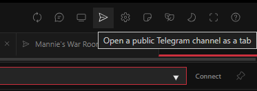

#### Scratchpad

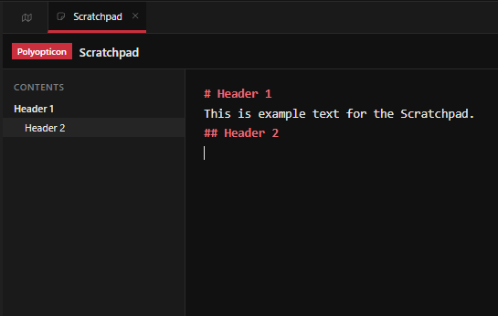

The **Scratchpad** button in the toolbar opens the Scratchpad as a tab: one permanent note, like a notepad document.
Paste or type text (Markdown is highlighted) and paste or drop images into it: each image appears inline,
right where it was pasted. Click it to enlarge (then scroll to zoom in and out, drag to move), drag its corner or Ctrl+scroll over it to resize,
and use the delete button (or Delete) to remove it. The article bar's **Add to Scratchpad** button adds a link to the open article.

It saves automatically: after a short pause in typing, when you leave or close the tab, and when the app closes. It is stored encrypted with your
Windows account (`scratchpad.bin`). If Windows encryption is unavailable it is not written to disk at all.

#### 4chan

The toolbar's optional **4chan** button opens 4chan /pol/ as a live-only tab (hide the button in Settings -> General). Middle-click any link there to open it in a background tab. No copies of these pages are saved. They run on their own browser session, apart from articles, whose logins, cookies and cache last between launches (see [Site Logins and Cookies](#site-logins-and-cookies)).

#### Keyboard Shortcuts

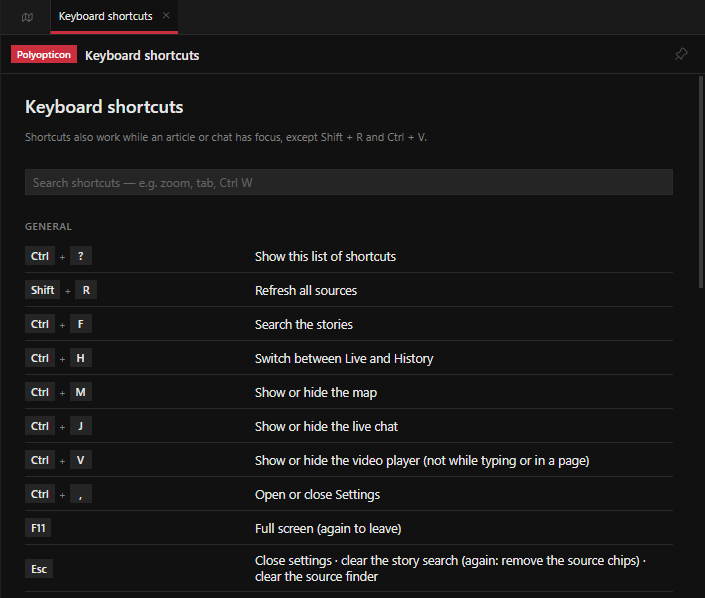

**Ctrl+?** (or the **Keyboard shortcuts** button in the toolbar) opens the full list of keyboard shortcuts and mouse actions in a tab, with a search box. The list comes from `src/renderer/shortcuts.js`, which also decides which keys the app handles. Add new shortcuts there and they show up in the list automatically.

## Live Chat View

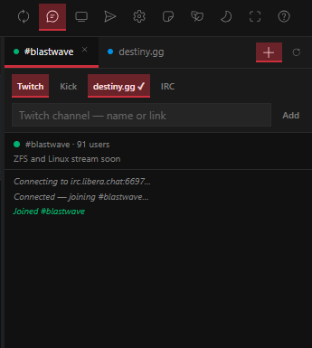

**Chat** (toolbar, Ctrl+J) opens a column on the right with Twitch and Kick channel chats, the destiny.gg chat and
IRC rooms, one tab each. The column is hidden and no chats are set up on a fresh install. All chats stay connected while the column is hidden.

### Adding a Chat

The **+** button in the column's header shows a row of chat types:

- **Twitch:** a field for the channel name or link. Read-only (guest), and follows the app's light/dark theme.
- **Kick:** a field for the channel name or link. The chat is Kick's embed at `chat.kick.cx/embed/<channel>`.
- **destiny.gg:** switches the chat on or off (no details needed). Read-only (guest).
- **IRC:** fields for a server and a room. **Connect** joins the room anonymously: a random guest nick,
  no password, no login. Connections use TLS by default (`irc.libera.chat`, or with a port,
  `irc.example.org:6697`). Use `irc://host:6667` for a plain-text server. IRC rooms are read-only and
  reconnect by themselves if the link drops. The log shows the connection steps (connecting, connected,
  joined) and people joining, leaving, quitting, changing nick, being kicked and topic changes.

Twitch and destiny.gg chats run on their own browser session and open links in your browser. Chats can also be managed in Settings -> General -> Live chat.

### Chat Tabs

Each chat is a tab, and they work like every other tab strip (see [Tabs](#tabs)). A tab leads with its site's icon (Twitch, Kick, destiny.gg), fetched once and cached like a feed's; an IRC room has a chat glyph instead. **Reload** (the button beside **+**, or Ctrl+R) reloads the chat that's showing. The order and pins are remembered.

## Video Player View

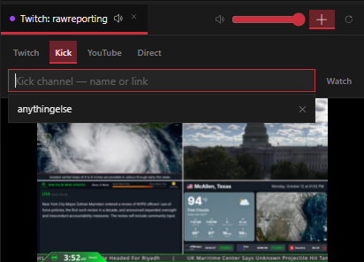

The **Split** button (toolbar, Ctrl+V) adds a stream player below the chat, opening the chat if it is hidden. Several streams can play at once, and they keep playing while you switch between tabs.

### Adding a Stream

Press the **+** button in the stream bar (it works like the chat's), pick a site, type a channel (or paste its link, which picks the site for you) and press **Watch**:

- **Twitch:** a channel name or link.
- **Kick:** a channel name or link.
- **YouTube:** an `@handle` or channel ID. Plays that channel's `/live` page, trimmed to just the video.
- **Direct:** a link to a video or audio file (`.mp4`, `.webm`, `.mp3` and so on), played in the built-in video player on its own in-memory session. An `rtmp://` (or `rtmps://`) stream link works here too, e.g. `rtmp://host/app/stream`: the app fetches the stream itself and plays it, and tries again by itself if the stream ends or isn't live yet (H.264 video with AAC or MP3 audio; no logins or encrypted RTMPE).

### Stream Tabs

Each stream is a tab, and they work like every other tab strip (see [Tabs](#tabs)), leading with its site's icon (a direct link has a video glyph). Add as many as you like. **Reload** (the button beside **+**, or Ctrl+R) reloads the stream that's showing.

### Volume and Mute

Each stream has its own volume:

- **Volume slider** (stream header): sets the volume of the stream that's showing.
- **Speaker button** (stream header): mutes or unmutes the stream that's showing. Its icon follows the volume.
- **Speaker on each tab:** mutes or unmutes that stream without switching to it.

### Resizing

Drag the bar between chat and streams to resize. The streams stop when the split or the chat column is closed. The tabs, pins, split and height are remembered.

## Tabs

The [Article View](#article-view), [Live Chat View](#live-chat-view) and [Video Player View](#video-player-view) each have their own tab strip, and all three work the same way. Keyboard shortcuts act on the strip of whichever view you last clicked.

### Using Tabs

- **Click** a tab to switch to it, and **drag** it to reorder.
- **Close button** or **middle-click** closes a tab.
- **Right-click a tab** to pin or unpin it, [pop it out](#popping-a-tab-out) into its own window, close it, close the other tabs, or close the tabs to its right. Article tabs also have **Open in browser** and **Copy link**.
- **Mouse wheel** over a strip scrolls it sideways. Chat and stream strips always scroll this way, and the article strip does when *Settings -> General -> Scrollable tabs* is on.

### Popping a Tab Out

Right-click a tab -> **Pop out** moves it into a window of its own, which you can put anywhere (another monitor, say). It works for article tabs (the live page, the saved page or the reader view, whichever was showing), 4chan, Telegram and Wikipedia tabs, every chat (IRC rooms too) and every stream. The app's own pages (the Map, Political lean, Global Markets, the Scratchpad, the shortcut list) stay in the main window.

- The window shows the same page on the same browser session, so you stay logged in. A slim bar has Back / Forward / Reload, the title, full screen (F11) and **Return to main window**. Ctrl+R, Alt+Left / Right and the zoom keys work there too.
- The tab leaves its strip while it floats. **Return to main window**, Ctrl+W or closing the window puts it back, selected. A returned chat or stream opens the chat column if it was hidden.
- Popped-out chats and streams keep running while the chat column is hidden.
- Opening something that is already popped out brings its window to the front.
- Tabs floating when you quit float again at the next start, each window where you left it. Closing the main window closes them with it.

### Pinned Tabs

Pin a tab with right-click -> **Pin tab** or Ctrl+P. Article tabs also have a pin button in the [article bar](#article-bar). Pinned tabs:

- Stay at the left of the strip, marked with a pin.
- Have no close button, and ignore middle-click and Ctrl+W. Right-click -> **Close tab** still closes one.
- Are left open by **Close other tabs** and **Close tabs to the right**.
- Aren't counted by Alt+1 to 9.

### Keyboard

| Keys | Action |
|---|---|
| Ctrl+PgDown / Ctrl+PgUp | Next / previous tab (wraps around) |
| Alt+1 to 9 | Go to tab 1–9, counting after the pinned tabs |
| Ctrl+W | Close the current tab (pinned tabs stay open) |
| Ctrl+P | Pin or unpin the current tab |
| Ctrl+R | Reload the current tab |
| Ctrl+Shift+A | [Search the open tabs](#tab-search) |

The shortcuts also work while an article or chat page has focus.

### Tab Search

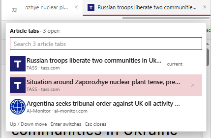

**Ctrl+Shift+A** searches the open tabs of whichever view you last clicked. A box opens below that view's tab strip, listing its tabs with the current one first. Article tabs follow it in the order you last used them, and chat and stream tabs in their strip order.

- **Type** to filter by title or site. Every word must match, and the matches are highlighted.
- **Up / Down** move the highlight, and **Enter** or a click switches to that tab.
- **Close button** on a row closes that tab without leaving the box. Pinned tabs show a pin instead and can't be closed from here.
- **Esc**, a click anywhere else, or Ctrl+Shift+A again closes the box.

With nothing typed, the highlight starts on the second tab, so **Ctrl+Shift+A, Enter** jumps back to the tab you were on before.

## Settings

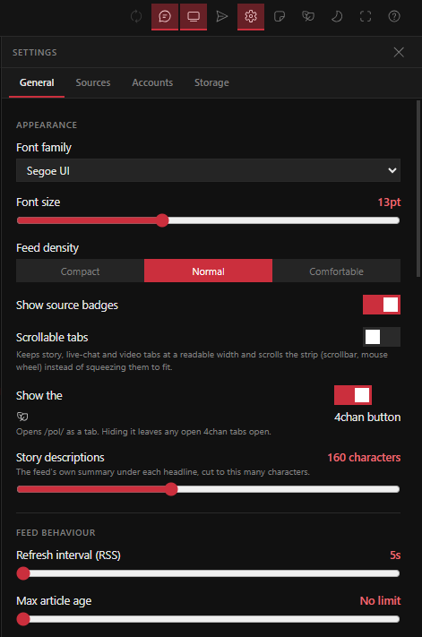

The **Settings** button (Ctrl+,) opens the panel. Esc or the close button closes it. It has four tabs:

- **General:**
  - *Appearance:* font, font size, feed density, source badges, scrollable tabs, the 4chan button, and description length.
  - *Feed behaviour:* refresh interval, max article age, max items in the live feed, always open in browser, and grouping.
  - *Translation:* the large NLLB model, and Stop all translation.
  - *Live chat:* Twitch and Kick channels, destiny.gg, and IRC rooms (also set from the chat's **+**).
  - *Article viewer:* default page zoom, Reader text width (a readable column, or the full width of the tab) and the screenshot folder.
  - *Video* (Linux only): decode video on the graphics card instead of the CPU, through VA-API: Intel, AMD and NVIDIA cards and integrated graphics. Each needs its VA-API driver installed: `intel-media-driver` for Intel (`libva-intel-driver` for chips older than Broadwell), Mesa's driver for AMD (part of `mesa` on Arch, `mesa-va-drivers` on Debian and Ubuntu), `libva-nvidia-driver` for NVIDIA. Without one the CPU decodes as before. Takes effect on restart; the session log then lists the formats the card decodes. Windows already does this.
  - *Polling:* the delay between sources at start (takes effect on restart).
  - *Media bias:* how far the [bias lookups](#bias-chart) have got, and **Recheck**.
  - *Logs:* how many session logs to keep, and debug logging.
- **Sources:** add, edit, enable and disable sources, grouped like the sidebar.
- **Accounts:** API keys and logins (Telegram, Bluesky, The Guardian, New York Times, NewsAPI), encrypted with Windows DPAPI. On Linux they are encrypted with a key kept in the desktop's keyring (GNOME Keyring, KWallet or any other Secret Service keyring); without one, they can't be saved.
- **Storage:** how much is saved, how long saved pages are kept, **Open data folder**, **Clear articles** and **Clear models**.

### Data Folder

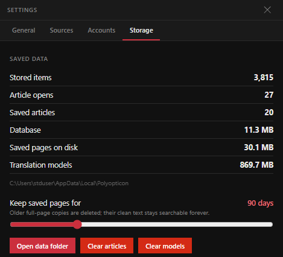

Everything the app stores lives outside the repository, in `%LocalAppData%\Polyopticon\`:
`polyopticon.db` (items, history, saved text, and each feed's bias lookup), `snapshots/` (saved pages), `models/` (translation models),
`icons/`, `thumbs/`, `logs/`, `polls/` (the last copy of each country's polls), `accounts.bin` (encrypted keys and sessions), `scratchpad.bin` (the encrypted Scratchpad note), and `settings.json`, `tags.json`,
`ui.json`, `pinned.json` (the open tabs).

The app reopens the way you left it: window size, position and maximised state, pane widths,
which views are hidden, unticked sources, popped-out tabs and where their windows were, Live/History (and its scope), the Group / auto-scroll / case toggles, the map and its
time window, your Global Markets groups, the opinion polls' range, the chat column (`ui.json`), keyword filters (`tags.json`), and the open tabs (`pinned.json`).

To run a separate copy with its own data (e.g. for testing), set `POLYOPTICON_DATA_DIR` to another folder
before `npm start`.

### Site Logins and Cookies

Article, chat and 4chan / Telegram tabs each run on their own browser session, and each keeps its logins,
cookie-banner answers, site storage and cache between launches, as a browser that continues where it left off does.
Cookies with an expiry date, site storage and the cache are kept by the browser engine in the folder below. Session cookies
(the ones a browser would drop on exit, which many sites use for a login or a cookie choice) are saved a few seconds after
they change and at exit, to `session-cookies.bin` (encrypted where the system offers it), and set again at the next start
before any page loads (`src/main/websession.js`).

Logins, cookies and the page cache live in Electron's browser folder, `%AppData%\Polyopticon\` (`Partitions\articles`,
`Partitions\chat`, `Partitions\chan`, and `session-cookies.bin`). Deleting those while the app is closed signs you out of every site.
Direct video links in the video area still use a memory-only session.

### Ad Blocking

Article and 4chan pages block ads and trackers: a built-in list of ad/tracker hosts, plus EasyList and EasyPrivacy through Ghostery's adblocker engine (URL rules and hiding of empty ad slots). The lists download in the background on first launch, are kept in the data folder and refresh weekly (`src/main/blocker.js`).

## Project Structure

```
├── package.json            scripts, dependencies, electron-builder config
├── scripts/
│   ├── build-geo.js        builds the gazetteer and the offline world map
│   └── build-icons.js      builds icons.js from Fluent UI System Icons
└── src/
    ├── main/               Electron main process (Node)
    │   ├── main.js         entry: window, IPC, webview security, reader view, startup
    │   ├── feed-worker.js  utility process hosting the source adapters; writes items to SQLite
    │   ├── translator.js   utility process running the translation models
    │   ├── adapters/       one adapter per source type; types.js describes their settings; pacing.js decides how often feeds are polled
    │   ├── enrich/         language detection, story grouping, place tagging (gazetteer.json)
    │   ├── page/           scripts injected into article pages before saving (cleanup, extraction, images)
    │   ├── db.js           SQLite schema, migrations and queries (node:sqlite, FTS5)
    │   ├── snapshots.js    MHTML + text capture, background capture, retention
    │   ├── bias.js         political-lean lookups (MediaBias News), one per feed, kept in the database
    │   ├── markets.js      live quotes for Global Markets (Yahoo Finance, batched, with back-off)
    │   ├── polls.js        opinion polls: Wikipedia's poll tables, parsed and cached
    │   ├── poll-countries.js  each country's poll questions and the Wikipedia tables they come from
    │   ├── favicons.js     site icons, fetched once and cached
    │   ├── thumbs.js       story pictures from feeds, shrunk and cached for a week
    │   ├── chat.js         chat-panel session and webview lock-down
    │   ├── popout.js       windows for popped-out tabs
    │   ├── irc.js          anonymous, read-only IRC connections for the chat column
    │   ├── fourchan.js     4chan tabs: own session, middle-click -> new tab
    │   ├── websession.js   site logins and cookie choices kept between launches (session cookies)
    │   ├── perfwatch.js    CPU / hang watchdog for the session log
    │   ├── rtmp.js         RTMP client: an rtmp:// stream as FLV for the stream player
    │   ├── secrets.js      encrypted API keys and sessions (Windows DPAPI)
    │   ├── blocker.js      ad/tracker blocking (host list + EasyList) for article and 4chan tabs
    │   ├── config.js       default sources (seeded on first run, added on upgrade)
    │   ├── store.js        settings.json, tags.json, ui.json, pinned.json
    │   ├── logger.js       session and debug logs
    │   └── preload.js      the `window.polyopticon` bridge to the UI
    └── renderer/           UI: plain ES modules, no build step
        ├── index.html, styles.css
        ├── app.js          entry: boot, toolbar, keyboard, splitters
        ├── icons.js        the button icons (generated by scripts/build-icons.js)
        ├── telegram.js     parsing Telegram channel names and t.me links for the Telegram button
        ├── streams.js      Twitch / Kick / YouTube stream names, links and player pages for the split
        ├── rtmp-player.*   the page that plays an rtmp:// stream (with mpegts.js)
        ├── reorder.js      drag-to-reorder for the tab strips (articles, chats)
        ├── popouts.js      which tabs are popped out; popout.html / popout.js: the page in a pop-out window
        ├── layout.js       showing / hiding the Sources & Filters and Article List views
        ├── feed.js, history.js, tabs.js, scratchpad.js, map.js, bias.js, markets.js, polls.js, chat.js, irc.js, sidebar.js, settings.js, sourcesearch.js
        ├── state.js, ui.js, dom.js
        └── assets/         logo, offline world map, icon licence
```

## API Usage

Polyopticon follows the usage policies of the services it requests data from. When it fetches the map's place photos from Wikimedia Commons, it:

- identifies itself with a descriptive User-Agent that links back to this repository, as the [User-Agent policy](https://foundation.wikimedia.org/wiki/Policy:Wikimedia_Foundation_User-Agent_Policy) asks;
- keeps under 200 requests a minute, the limit for clients that identify themselves, and waits as told when a server answers that it's busy (`429` / `Retry-After`), slowing down until it recovers;
- downloads in the background, saves every photo it gets, and never fetches a saved photo again.

The facts and summaries (Wikidata, Wikipedia) are fetched when the map data is built, not by the app.

The opinion polls are at most two MediaWiki API requests per check (revision numbers, then the text of pages edited since), for the country shown only, with the same User-Agent, at most every 30 minutes and only while that view is open; a busy or blocked answer is waited out as above.

## Credits

Place data from [GeoNames](https://www.geonames.org/) (CC BY 4.0) and [Natural Earth](https://www.naturalearthdata.com/) (public domain). US county outlines: [US Census Bureau](https://www.census.gov/geographies/mapping-files/time-series/geo/cartographic-boundary.html) (public domain). Canada's census divisions: [GADM](https://gadm.org/) (free for non-commercial use; downloaded by the app, not distributed with it). Place facts: [Wikidata](https://www.wikidata.org/) (CC0). Summaries: [Wikipedia](https://en.wikipedia.org/) (CC BY-SA 4.0). Photos: [Wikimedia Commons](https://commons.wikimedia.org/), each under its own licence, credited on its card.

Political-lean ratings: [MediaBias News](https://mediabias.news), republishing AllSides, Ad Fontes Media and Media Bias/Fact Check. Market prices: Yahoo Finance. Opinion polls: [Wikipedia](https://en.wikipedia.org/wiki/Category:Opinion_polling_for_elections) (CC BY-SA 4.0), compiled from each polling firm's published results.

Translation models: Helsinki-NLP Opus-MT and Meta NLLB-200, via Transformers.js.

Article extraction: Mozilla Readability. Map: Leaflet.

Icons: [Fluent UI System Icons](https://github.com/microsoft/fluentui-system-icons) by Microsoft (MIT, see `src/renderer/assets/fluent-icons-LICENSE.txt`).

<hr>

<p align="center">
  <a href="https://rethy.xyz"></a>
</p>
